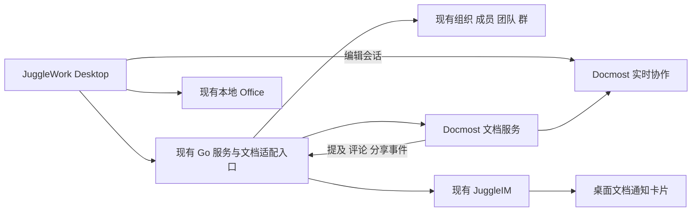

# JuggleWork 对标飞书文档的项目适配评估

> 适用范围更新：本文最初按功能和接入成本排序。新增“全部关键模块源码公开并可自行构建”硬要求后，以[全源码选型评估](cloud-document-full-source-evaluation.md)为准：文字云文档优先验证 La Suite Docs，AFFiNE 保留备选；Docmost 的 EE 后端不在公开主仓库中。

日期：2026-11-05。范围：复用现有组织、成员、团队、IM、桌面端和本地 Office，比较协作文档项目的功能、源码边界和接入成本。商用授权和价格不参与本轮排序。

## 选型结论

**若首版聚焦协作文字文档与知识库，当前 JuggleWork 优先验证 `docmost/docmost`。** 保留现有账号、组织、团队、IM、Agent 和本地 Office，由 Docmost 提供文档编辑、实时协作、目录、评论、历史及文档访问控制。推荐依据是模块完整性和接入位置的可识别性，不是已完成的性能或兼容性实测。[1][2][3][4][5]

这一结论对应“补齐飞书式文档协作，同时复用现有 Office”的目标。**如果首版要求文字文档、电子表格、PPT、多维表和白板全部在线实时协作，应将 `dream-num/univer-workspace` 提升为主要 PoC 对象。** 它的官方产品覆盖更接近这一整套范围，但使用另一套 Office 模型和协作 SDK，不能直接复用当前原生 Office 内核。[19][20][21]

建议选择关系如下：

| 目标 | 优先项目 | 原因 |
| --- | --- | --- |
| 在现有 JuggleWork 中增加协作文档、知识库和 IM 联动 | **Docmost** | 已有文字文档协作闭环；保留现有产品外壳，重点适配身份和通知 |
| 同时建设在线文档、表格、PPT、多维表、白板 | **Univer Workspace** | 内容类型覆盖更完整，已有应用层和协作接入，但需接受新的编辑模型 |
| 文档与无限白板是同等重要的核心体验 | **AFFiNE／BlockSuite** | 同一块模型组织文档和画布，适合多模态内容 |
| 聚焦轻量协作文字文档，接受 Django 服务 | **La Suite Docs** | 文字编辑、共享、评论和外部 API 比较集中 |
| 主要是企业 Wiki、知识检索与发布 | **Outline** | Wiki 导向明确，已有 API、权限策略和协作服务 |
| 多视图数据库和 Notion 式项目空间优先 | **AppFlowy Web** | 应评估 Web 应用与其匹配的云服务，不能仅依据原生客户端判断 |

上述排序是工程判断。“已有组织和 IM”减少身份与通知的重复开发；文档 ACL、实时编辑状态、评论锚点和历史恢复仍由文档系统承担。

## 已有能力及其复用价值

本地检查基线：Desktop `0597a5916`；Server `b2c681f`。另检查了本地 `origin/dev` 的待合入提交，所列服务端组织、成员、群和 IM 核心文件没有差异。以下依据工作区源码，不表示已验证部署环境。

| 已有能力 | 源码事实 | 文档接入用途 |
| --- | --- | --- |
| 组织与成员 | 有全局 User、组织成员边、状态、角色与当前组织切换 | 组织和用户继续以 JuggleWork 为唯一权威来源 |
| 团队与群 | `OrganizationTeam` 与群成员分别建模，团队可关联 Team 群 | 可作为文档用户组映射来源，不能把团队、聊天群和知识空间混成一种对象 |
| IM 身份 | 当前登录注册把业务 `user.ID` 传给 JuggleIM，成员接口也以此返回 `imUserId` | 文档通知可经映射直接定位现有 IM 用户 |
| IM 投递 | 服务端已有系统消息适配，桌面已有自定义通知消息类型和气泡 | 可复用投递通道；文档通知类型、卡片和定位仍需新增 |
| 成员移除 | 组织成员和派生 Team 权限由本地事务撤销，IM 是派生镜像 | 文档成员及在线编辑连接也要跟随撤销，不能只删除通讯录显示 |
| 桌面组织切换 | 切换时更新活跃组织并重新接收 IM bootstrap | 云文档会话、缓存和标签页需要加入同一组织切换生命周期 |
| 本地 Office | 现有 Server 管理原生模型、保存和 AI 工具，Electron 承载编辑页 | 继续处理本地文件；新增云文档编辑入口，不直接替换现有保存协议 |

本地依据：

- [Server 组织、用户、成员、团队与群模型](../../jugglework-server/storages/models/models.go)
- [Server 组织切换与成员角色](../../jugglework-server/services/organization.go)
- [Server 成员移除](../../jugglework-server/services/members.go)
- [Server IM 登录身份](../../jugglework-server/services/im_login.go)
- [Server 成员接口投影](../../jugglework-server/apis/members.go)
- [Server 系统消息适配](../../jugglework-server/services/juggleim.go)
- [Desktop 登录与组织切换](../apps/app/src/react-app/domains/cloud/den-auth-provider.tsx)
- [Desktop 群成员适配](../apps/app/src/react-app/domains/jugglechat/api.ts)
- [Desktop 自定义 IM 通知消息](../apps/app/src/react-app/domains/jugglechat/automation-event-message.ts)
- [现有 Office 设计](office-document-editing-design.md)

当前代码中的业务用户 ID 与 IM 用户 ID 已打通。第三方文档用户仍应显式映射到业务用户 ID，不以手机号、显示名或可修改邮箱作为稳定身份。

## 飞书文档的对标范围

飞书官方将文档、表格、多维表格等纳入云文档权限体系，支持用户、群组等协作者以及阅读、编辑、管理权限。其知识库还包含页面树、@提及、评论及通知。[6][7]

本次因此按下列能力评估，而不只看“是否有富文本编辑器”：

| 维度 | 应达到的行为 |
| --- | --- |
| 内容协作 | 多人同时编辑、看到光标、断线后恢复、评论锚点随内容变化 |
| 文档组织 | 个人及团队文档、层级目录、搜索、最近访问、回收站 |
| 权限协作 | 组织隔离、文档共享、阅读／编辑、成员退出后的访问失效 |
| IM 联动 | 文档链接卡片、@和评论通知、点击后定位到对应文档及评论 |
| AI 协作 | Agent 通过同一内容模型修改，保留用户编辑、历史和可追踪身份 |
| 桌面接入 | 现有账号免重复登录，复用窗口、主题和组织切换行为 |
| 多内容类型 | 明确文字文档、Excel 式表格、多维数据库及 PPT 的不同范围 |

**IM 负责消息和提醒，协作引擎负责编辑增量及在线光标。** 不建议用 JuggleIM 消息重新实现文档同步；也不建议为增加文档功能引入另一套企业通讯录和聊天产品。

## 为什么 Docmost 是当前首选

### 已有完整的文字文档协作链路

Docmost 的公开核心提供空间、嵌套页面、搜索、附件、评论和页面历史。其客户端是 React／TypeScript，服务端是 NestJS；协作实现使用 Hocuspocus 与 Yjs。[1][2][8][9]

源码显示，持久化扩展保存 Yjs 状态，并派生编辑器 JSON 与可搜索文本；同一链路还触发正文提及通知和历史处理。这比单独采用编辑器组件减少了需要自建的产品环节。[2]

**对 JuggleWork 的价值：** 可以把开发重点放在身份、组织、通知及桌面接入，避免从头建设文档树、评论服务和历史管线。这是代码结构推导出的复用价值，不是工期承诺。

### 评论和通知具有明确适配点

当前评论服务包含回复和 Yjs 选区标记处理；评论通知服务会计算被提及者、线程参与者或关注者，并过滤无空间／页面访问权限的用户。[3][4]

建议保留文档侧的事件与收件人计算，在通知投递位置增加 JuggleWork 适配：映射回业务用户 ID 后调用现有系统消息通道。正文提及、评论、回复和权限邀请应分别定义通知语义，不把每次按键变成一条 IM 消息。

通知卡片只负责导航。用户打开文档时仍按当前文档权限处理；发送链接本身不自动产生编辑权。

### 权限变更已有协作层处理入口

Docmost 的协作认证检查用户、workspace、页面及读写能力，并有重检在线连接、降为只读或关闭连接的代码。页面访问服务也明确区分空间访问和页面限制。[5][10]

这为组织成员退出、团队成员变化、文档权限调整后的在线处理提供了接入位置。适配时复用上游能力，不自行增加分布式锁或第二套协作算法。

### 保留服务边界比搬迁源码更合适

建议将 Docmost 作为独立文档服务，由现有 Go 服务提供组织、成员和业务身份的适配入口；桌面承载文档页面。避免把 NestJS、Yjs、上游 ORM 及文档存储全部重写进 Go／MySQL。

Docmost 不是可直接拿来挂载的完整 React 组件 SDK。第一步宜使用独立 Web 页面接入；确认编辑、会话和导航行为后，再评估抽取前端组件。已有 React 技术栈能够降低阅读成本，不证明其应用可以零成本嵌入。

## Docmost 与飞书仍有哪些差距

以下事项会影响最终是否选定，不能因忽略商用授权而忽略它们：

1. **公开源码范围。** 主仓库的 `apps/server/src/ee` 是指向独立 `docmost/ee` 的 Git 子模块；本次公开访问该仓库返回 404。前端存在企业功能页面，不代表相关后端实现随公开主仓库完整提供。[11] 官方把 Bases、页级细权限、SSO、正式 API、MCP 等列为独立版本功能；本轮不按费用扣分，但这些能力必须按实际可取得的服务端实现验证。[12]
2. **单文档共享语义。** 已核对的页面访问服务先要求空间访问，再处理页面限制。飞书式“只分享一个文档给原本不在该空间中的成员”不能直接假定等价，需要用真实场景确认或补齐。[10]
3. **账号模型。** Docmost 用户属于 workspace，其用户查询带 workspace 条件，默认创建逻辑依赖邮箱。JuggleWork 支持账号／手机号成员且用户跨组织存在，应按 `(organizationId, userId)` 显式建立映射，处理无邮箱用户，不仅依赖邮箱匹配。[13]
4. **多组织部署。** 需要验证 workspace 创建、路由和会话隔离；不能用一个 workspace 加一个组织标记，就假定拥有完整租户隔离。
5. **数据库规范。** Docmost 原始迁移包含外键及数据库侧删除关联处理，与当前项目“业务完整性在应用层处理、不引入外键”的约定不一致。[14] 正式采用前需要审查相关迁移及应用替代行为；独立部署不自动消除这项差异。
6. **Office 范围。** Docmost 的普通表格及 Bases 不等于 Excel；云文档状态也不等于原始 DOCX／PPTX。当前本地 Office 可以保留，但无法因此获得跨设备实时 Office 共编。

因此，推荐的是 **Docmost 核心＋明确范围的 JuggleWork 适配**。首个验证目标应是协作文字文档与知识库，而不是声称公开仓库已经完整覆盖飞书云文档。

## 其他候选的技术判断

| 项目 | 对当前系统的优势 | 主要新增工作／差异 | 选择条件 |
| --- | --- | --- | --- |
| **AFFiNE** | 文档、白板、数据库块及本地优先同步；当前已有评论和回复实现 | 融入其工作区、块模型、前端状态及后端运行时；当前权限和评论服务还委托给 BackendRuntimeProvider | 白板、多模态内容和离线能力是核心目标时，优先级提高 [15][16] |
| **BlockSuite 单独使用** | 可复用文档与白板编辑器，支持自定义块和 CRDT 状态 | 它是编辑框架，不赠送完整文档目录、文档 ACL、业务通知及知识库服务；需补产品层 | 希望长期自研编辑体验，接受更大开发投入 [17] |
| **La Suite Docs** | 专注文字文档、层级、共享、评论、在线光标；有外部 resource server API | 新增 Django／Python 服务及协作、转换服务；外部 API 默认动作有限且文档提示可能演进 | 文档优先、接受其服务栈，且单文档共享需求比 Wiki 更重要 [18][22][23] |
| **Outline** | React／TypeScript、Wiki、API、ProseMirror 编辑器；协作连接会随权限变化重检 | 仍要适配团队身份、用户组、文档通知与知识库语义；本轮不因 BSL 排除 | 企业 Wiki 和内容发布优先时，是有竞争力的备选 [24][25] |
| **AppFlowy Web** | React／TypeScript，富内容文档、Grid／Kanban 和公共／私有空间 | 需要匹配 AppFlowy 云端身份、协作协议与数据库模型；当前官方生产部署涉及多个服务 | 多维数据库与项目空间优先，接受使用完整匹配后端时再提升顺位 [26][27] |

AFFiNE 当前已有评论，不能再按早期“没有评论”评价。[16] AppFlowy 应评估其 Web 仓库，不应因原生客户端采用 Flutter 就判定无法接入 Electron。[26]

本轮降低它们的默认优先级，依据是新增系统的适配边界与当前缺口的匹配程度；没有将授权费、许可名称或 GitHub Star 数作为技术评分。

## 新增候选：Univer Workspace

### 为什么必须纳入完整云 Office 评估

`dream-num/univer-workspace` 不只是一个表格组件示例。官方将其定义为可部署的协作工作空间，包含 Browser、Server、CLI 及 Agent 入口；内容类型覆盖 Sheets、Docs、Slides、Bases 和 Boards。应用负责目录、空间、权限和分享，协作 SDK 负责实时状态、历史与草稿工作区协议。[19]

其应用采用 React／TypeScript／Vite、Express 和 SQLite；文档说明评论、历史及 Office 导入导出已有对应集成。这一覆盖范围，比单个知识库更接近“飞书云文档多类型内容”的目标。[20][21]

### 与当前 JuggleWork 的实际关系

- 可以复用 JuggleWork 的组织、成员和 IM，通过适配替换其产品身份及团队来源；不会因为两边都有 OAuth 字样就自动互通。其通用 OAuth 授权能力主要用于外部客户端向 Workspace 申请身份／会话，接入现有 JuggleWork 登录仍需具体设计。[20]
- 只评估 Browser、Server 和必要内容 SDK；已有 Agent 对话和桌面外壳继续由 JuggleWork 承担。
- 应用依赖版本匹配的 `@univerjs`、`@univerjs-pro` 协作与转换组件；这些是实际运行依赖。开源应用仓库不能被当成全部 SDK 实现源码。[19][21]
- 它的文件、选区、协作和 Facade API 与现有 `editor_sdk` 没有经验证的通用接口。需要新的 Agent 工具适配，不能只把服务地址改成远端 URL。
- 官方说明当前评论正文在 Trunk 与 Worktree 间共享，草稿中删除评论也会影响 Trunk；需要单独验证这种语义是否符合 JuggleWork 的 AI 草稿审阅体验。[20]

**综合判断：** 如果目标明确为多类型在线 Office，Univer Workspace 的功能方向更合适，应与 Docmost 同级甚至优先验证；如果目标是在现有 Office 之外补齐协作文字文档和 Wiki，Docmost 的引入范围更聚焦。两者不是用同一套“有文档／有表格”勾选就能比较的替代品。

## 推荐接入设计

以下为建议边界，尚未实施。

### 数据与权限归属

| 对象 | 权威归属 | 建议映射 |
| --- | --- | --- |
| 用户、组织、组织成员 | JuggleWork Server | `(orgId, userId)` → 文档 workspace／user；组织成员状态始终以现有服务为准 |
| 团队、群成员 | JuggleWork Server | 映射到文档用户组；团队与聊天群分别保存来源类型及 ID |
| 知识空间、目录、页面 | 文档服务 | `workspace` 表示文档租户；`space` 表示知识空间，不把每个聊天群都自动变成知识库 |
| 页面 ACL、评论、历史、协作状态 | 文档服务 | 按文档读写权限处理，不直接复制组织角色名称 |
| 消息投递、未读和桌面提醒 | 现有 IM／桌面能力 | 文档事件转为业务通知；不新增一套聊天服务 |
| 本地 Office 文件与模型 | 现有 Desktop／本地 Server | 维持当前文件和保存生命周期 |

组织管理员不应仅因管理组织成员就自动获得所有私密文档的编辑权；角色映射需要产品明确。个人组织目前在服务端禁用了协作等租户能力，这一既有行为需要在文档入口中延续或明确调整，不能因增加云文档而默默改变。

### 登录和组织切换

建议增加窄范围的文档会话适配：复用现有登录确认业务用户和当前组织，再由文档服务建立自己的编辑会话。内部服务调用沿用现有可信网络约定，无需为文档另建通用身份平台。

本次在已检查的服务端路由与服务中没有找到可直接作为完整 OIDC Provider 的证据。因此不能承诺“配置一个 OIDC 地址即可接入”。Docmost 协作 token 继续由其既有服务签发与消费。[5]

组织切换应关闭或重新绑定旧组织文档会话，缓存带上组织上下文；点击另一组织的文档卡片时，先明确切换到对应组织，再打开目标。该行为需要接入桌面现有生命周期。

### IM 文档协作

首版建议验证四条链路：

1. 文档内 @成员 → 文档侧形成通知 → 映射业务用户 → 现有 IM 投递 → 点击定位提及。
2. 选区评论或回复 → 复用线程和收件人计算 → 通知卡片 → 打开对应评论。
3. 分享到群 → 明确“只发链接”或“为该群成员授权” → 生成卡片；群成员变化后的权限跟随规则应明确。
4. 移除组织成员或撤销文档权限 → 更新文档访问 → 在线协作连接同步失效，通知与深链不能恢复已撤销权限。

JuggleWork 已有上述链路中的身份和传输基础；文档事件适配、卡片类型和深链定位尚未实现。

### Agent 与现有 Office

Docmost 的协作状态、编辑器 JSON 和搜索文本由同一持久化链路维护。[2] Agent 修改应进入文档服务／协作模型，避免只写数据库 JSON 而留下旧 Yjs 状态。可以复用现有 Agent 工具注册机制，但文档工具本身需要新增。

现有 Office 继续处理 DOCX、XLSX、PPTX 本地编辑；云文档作为独立资源类型挂入既有窗口及标签页。导入导出属于格式转换，不承诺块文档与 Office 文件无损双向同步。

## 如何确定最终采用

建议先做一个 **Docmost 接入 PoC**，用结果决定是否正式采用，而不是立即搬迁其全部源码：

- 两个真实业务成员在桌面打开同一文档，验证中文输入、实时协作、选区评论、回复及刷新恢复。
- 无第二次注册登录；组织 A／B 分别创建同名文档，组织切换、成员退出和旧标签页行为符合预期。
- 从现有团队／群选择协作者，完成阅读、编辑、撤销；验证不在空间中的成员能否只获得单篇文档权限。
- 完成 @、评论通知及 IM 卡片定位，确认分享和授权含义一致。
- Agent 与用户编辑同一文档，验证内容、历史、评论锚点和恢复不互相覆盖。
- 确认所需页面权限及共享后端可取得，原始迁移调整符合项目无外键约定；不预设上游原版可以直接照搬。

如果“表格、PPT、多维表也必须在线共编”进入首版硬性范围，用同样的账号、权限和 IM 场景验证 Univer Workspace，并增加跨格式样本、历史恢复及 Agent 工具验证。此时不能把“当前本地 Office 已存在”作为云端共编能力已完成的证明。

Docmost 与 Univer 都应检查产品库及协作存储是否符合项目的无外键规则；本次只证实了 Docmost 原始迁移的差异，没有证明 Univer 或其他候选已经符合该规则。

本轮没有启动候选服务、执行其迁移、跑性能压测或验证真实多人编辑。因此结论用于优先投入验证；不同部署规模和内容样本可能改变结果。正式采用应锁定发行版，本次源码抽查使用的默认分支快照不等同于生产发行承诺。

## References

[1] [Docmost 功能与核心模块](https://raw.githubusercontent.com/docmost/docmost/33e47abca316e9f24d78d401e3dfa233efe1756b/README.md)

[2] [Docmost 协作持久化、提及和历史处理](https://raw.githubusercontent.com/docmost/docmost/33e47abca316e9f24d78d401e3dfa233efe1756b/apps/server/src/collaboration/extensions/persistence.extension.ts)

[3] [Docmost 评论与选区标记服务](https://raw.githubusercontent.com/docmost/docmost/33e47abca316e9f24d78d401e3dfa233efe1756b/apps/server/src/core/comment/comment.service.ts)

[4] [Docmost 评论通知收件人及访问过滤](https://raw.githubusercontent.com/docmost/docmost/33e47abca316e9f24d78d401e3dfa233efe1756b/apps/server/src/core/notification/services/comment.notification.ts)

[5] [Docmost 协作身份、读写权限及在线重检](https://raw.githubusercontent.com/docmost/docmost/33e47abca316e9f24d78d401e3dfa233efe1756b/apps/server/src/collaboration/extensions/authentication.extension.ts)

[6] [飞书云文档权限](https://www.feishu.cn/hc/zh-CN/articles/360025093793-%E5%BF%AB%E9%80%9F%E4%B8%8A%E6%89%8B%E4%BA%91%E6%96%87%E6%A1%A3%E6%9D%83%E9%99%90)

[7] [飞书知识库与协作](https://www.feishu.cn/hc/zh-CN/articles/807073676453-%E9%A3%9E%E4%B9%A6%E7%9F%A5%E8%AF%86%E5%BA%93-%E6%9E%84%E5%BB%BA%E4%BC%81%E4%B8%9A%E4%B8%8E%E4%B8%AA%E4%BA%BA%E7%9A%84%E4%B8%93%E5%B1%9E%E6%99%BA%E5%BA%93)

[8] [Docmost 客户端技术栈](https://raw.githubusercontent.com/docmost/docmost/main/apps/client/package.json)

[9] [Docmost 服务端技术栈](https://raw.githubusercontent.com/docmost/docmost/main/apps/server/package.json)

[10] [Docmost 页面与空间访问语义](https://raw.githubusercontent.com/docmost/docmost/33e47abca316e9f24d78d401e3dfa233efe1756b/apps/server/src/core/page/page-access/page-access.service.ts)

[11] [Docmost 独立企业后端子模块](https://raw.githubusercontent.com/docmost/docmost/33e47abca316e9f24d78d401e3dfa233efe1756b/.gitmodules)

[12] [Docmost 功能及版本范围](https://docmost.com/docs/)

[13] [Docmost workspace 用户与默认创建逻辑](https://raw.githubusercontent.com/docmost/docmost/33e47abca316e9f24d78d401e3dfa233efe1756b/apps/server/src/database/repos/user/user.repo.ts)

[14] [Docmost 默认迁移中的外键示例](https://raw.githubusercontent.com/docmost/docmost/33e47abca316e9f24d78d401e3dfa233efe1756b/apps/server/src/database/migrations/20240324T086100-add-workspace-fk.ts)

[15] [AFFiNE 内容模型与本地优先协作](https://raw.githubusercontent.com/toeverything/AFFiNE/canary/README.md)

[16] [AFFiNE 当前评论、回复与后端运行时调用](https://raw.githubusercontent.com/toeverything/AFFiNE/8bbbfcf07874078bcb37cf88c40b81002382d0ba/packages/backend/server/src/core/comment/service.ts)

[17] [BlockSuite 编辑框架与协作模型](https://blocksuite.io/guide/overview.html)

[18] [La Suite Docs 功能](https://raw.githubusercontent.com/suitenumerique/docs/main/README.md)

[19] [Univer Workspace 产品范围与责任边界](https://raw.githubusercontent.com/dream-num/univer-workspace/main/README.md)

[20] [Univer Workspace 应用、评论、历史及身份接入](https://raw.githubusercontent.com/dream-num/univer-workspace/main/apps/workspace/README.md)

[21] [Univer Workspace 应用技术架构](https://raw.githubusercontent.com/dream-num/univer-workspace/main/apps/workspace/docs/architecture.md)

[22] [La Suite Docs 外部 API 与开放动作](https://raw.githubusercontent.com/suitenumerique/docs/3799ef60cec43b3a939b0fd2b3a775ce9f824e5a/documentation/resource_server.md)

[23] [La Suite Docs 部署服务组成](https://raw.githubusercontent.com/suitenumerique/docs/3799ef60cec43b3a939b0fd2b3a775ce9f824e5a/documentation/installation/README.md)

[24] [Outline 前后端、API、权限策略与编辑器架构](https://raw.githubusercontent.com/outline/outline/4b6512de516e0201f3a2931ec544399026807c34/docs/ARCHITECTURE.md)

[25] [Outline 协作权限变化与连接重检](https://raw.githubusercontent.com/outline/outline/4b6512de516e0201f3a2931ec544399026807c34/server/collaboration/AuthenticationExtension.ts)

[26] [AppFlowy Web 的 React 应用与文档／数据库功能](https://raw.githubusercontent.com/AppFlowy-IO/AppFlowy-Web/main/README.md)

[27] [AppFlowy 当前生产自托管服务与配套升级范围](https://raw.githubusercontent.com/AppFlowy-IO/AppFlowy-SelfHost-Commercial/main/README.md)
