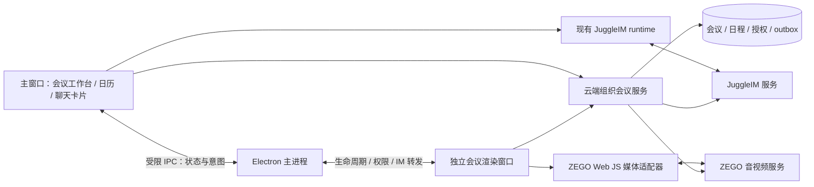
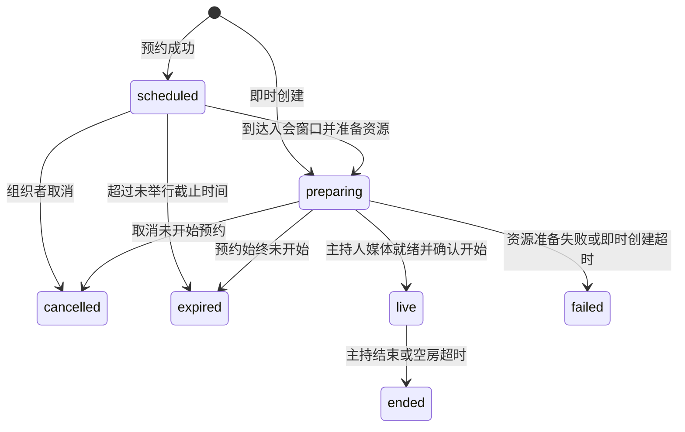

# 技术架构与协议草案

本文件中的新模块、API、消息名和字段均为拟议契约，不代表后端已实现。服务端仓库已确认是 `/Applications/work/jugglework-server`；具体部署配置和接口前缀在联调时对齐。

## 1. 现有代码核查

| 位置（仓库根目录相对路径） | 现状与设计影响 |
| --- | --- |
| `openspec/project.md` | Desktop 为 Electron + React，pnpm monorepo；渲染、IPC 和主进程边界已存在 |
| `apps/desktop/package.json` | Electron 固定为 44.0.0；以实际打包版本开展媒体验证 |
| `apps/app/src/react-app/shell/app-navigation-rail.tsx` | 消息／通讯录使用聊天 store 的不同 view，会议应成为独立一级业务入口 |
| `apps/app/src/react-app/domains/jugglechat/runtime.ts` | 单例 IM runtime、自定义消息注册、事件订阅和消息发送；可以扩展会议 adapter |
| `apps/app/src/react-app/domains/jugglechat/store.ts` | 现有连接、会话、消息及组织通讯录状态；复用身份与目录，避免会议功能另建 IM 登录 |
| `apps/app/src/react-app/domains/jugglechat/api.ts` | 已区分 Chat 应用 API 与组织 API；会议业务契约归组织服务，不能默认放进本地 sidecar |
| `apps/app/src/react-app/domains/jugglechat/call-store.ts` | 既有 JuggleCall 通话状态 idle/incoming/calling/connected；群发起路径目前返回需先选择成员的提示，不是完整群会议 |
| `apps/app/src/react-app/domains/jugglechat/components.tsx`、`jugglechat-app.tsx` | 现有 CallOverlay 随聊天应用渲染；新会议不能依赖用户停留在聊天页 |
| `apps/app/src/react-app/domains/jugglechat/runtime.ts#getCallClient` | 已加载 `ZegoExpressWebRTC-3.12.0.js` 并初始化 JuggleCall，AppID 在代码中写定；新方案应由组织能力配置下发 AppID |
| `apps/app/public/jugglechat/vendor/ZegoExpressWebRTC-3.12.0.js` | 已有本地 SDK 资源；需核查版本许可和兼容，不直接按最新文档推断此版本全功能可用 |
| `apps/desktop/electron/media-permissions.mjs` | 当前仅主窗口获准音频采集，视频不被允许；新会议窗口需要显式受信任身份与权限支持 |
| `apps/app/src/app/lib/desktop.ts`、`apps/desktop/electron/main.mjs` | 现有 desktop bridge 与窗口生命周期接入点 |
| `apps/app/src/react-app/domains/settings/google-workspace-config.tsx` | 存在外部日历能力配置；本次检查未发现可直接承载会议的独立日历领域，不把外部连接器当会议主库 |

结论：复用 JuggleIM runtime 和通讯录；新增独立 meeting 领域、业务状态机与媒体适配。JuggleCall 仅服务既有音视频呼叫，Meeting 不依赖 JuggleCall、不调用 getCallClient、不复用 call-store 或 JuggleCall 会话状态机。Meeting 的呼叫使用 JuggleIM 自定义消息，媒体直接调用独立的 ZEGO adapter。

### Server 已核查的接入位置

`jugglework-server` 是现有 Go 后端，使用 Gin 路由和 GORM/MySQL。`routers/router.go` 注册服务，`apis/` 承载 HTTP 层，`services/juggleim.go` 已封装 JuggleIM adapter，`storages/models/models.go` 有组织 IM 配置。`go.mod` 固定 `imserver-sdk-go v1.0.16`，本机 SDK 源码可见 CreateChatroom、DestroyChatroom、SendChatroomMsg 和聊天室禁言／禁入接口；当前项目 adapter 尚需扩展聊天室边界。这是源码能力核查，不代表已通过部署联调。

实现遵循 Server AGENTS.md：优先简单清晰的业务逻辑；不引入复杂锁或分布式并发框架；必要重复请求去重与状态检查在应用层完成；不增加外键或 CHECK 业务约束；内部服务通信沿用可信内网约定。Desktop 用户身份、组织范围及主持人操作仍在面向客户端的业务接口校验。

## 2. 职责与架构



- ZEGO：房间媒体登录、音视频采集推拉、共享流和媒体质量事件。业务上不接 ZEGO ZIM，不用房间媒体属性替代业务主库。
- JuggleIM：邀请、会议卡片、控制变更通知、会内文字与举手互动；使用当前组织已有连接。
- 会议服务：组织鉴权、会议生命周期、邀请与群资格、主持权、容量、RTC token、提醒、状态快照、事件版本和审计。
- Desktop 主进程：受信任会议窗口、媒体会话互斥、屏幕来源、权限、通知、退出协调。不得生成供应商服务端 token。
- 本地缓存：只加速显示；离线不能创建权威会议、开始新会议或作主持管理。恢复网络时重新校验。

服务端依赖必须单独排期。本仓库有本地运行时并不意味着可以让某个用户电脑成为全员会议和提醒的权威服务。

## 3. 窗口、连接和旧通话兼容

推荐独立 BrowserWindow 承载会前预览及媒体，主窗口承载唯一 IM 连接。会议窗口通过窄 IPC 调用会议 IM adapter，不初始化第二个 JuggleIM 客户端，避免重复登录、双响铃和事件重复消费。

主窗口关闭到托盘时不销毁承载 IM 的渲染器。主渲染器重载时会议媒体可继续，IM 功能标记恢复中；通过会议 API 快照补齐控制状态，IM 重连后恢复消息。若当前窗口销毁策略无法满足，先在技术验证阶段解决连接宿主常驻，再开放独立会议窗口。

拟议 IPC 仅包括 open/focus、状态订阅、会议消息发送、设备权限查询、屏幕来源选择、leave/close。验证发送窗口 ID、组织 ID、当前会议 ID 和 payload schema，禁止任意 URL、任意会话 ID 发送、任意调用 runtime 方法。窗口启用隔离与 sandbox，不给 Node 能力。

主进程提供全局 `MediaSessionCoordinator`：预览、旧 JuggleCall、会议共享同一个占用锁。旧通话中发起会议时提示先结束通话；会议中收到旧通话显示忙线，不自动切换。跨设备通过服务端会话租约处理：首期禁止第二设备直接抢占，可显式「转移到此设备」，原设备收到失效事件后停止媒体；强制踢出能力需验证。

现有全局 `window.ZegoExpressEngine` 和 JuggleCall 内部 engine 不与新会议混用实例。新增适配器固定 SDK 版本；优先验证现有 3.12.0，若必须升级则独立说明升级影响和旧通话回归范围。不能简单再导入另一个版本覆盖同一个全局对象。

## 4. 数据模型

| 实体 | 建议主要字段及约束 |
| --- | --- |
| Meeting | id、orgId、title、description、sourceKind(workbench/group/direct)、sourceConversationId/type、organizerId、hostId、status、version、meetingCode、plannedStartAt/EndAt、timezone、actualStartAt/EndAt、policy、rtcRoomId、chatroomId |
| MeetingInvitation | id、meetingId、inviteeId、inviterId、rsvp、revokedAt、version；同一会议和用户幂等合并 |
| MeetingParticipant | meetingId、userId、role、firstJoinedAt、lastLeftAt；记录实际参会，不与 RSVP 混用 |
| ParticipantSession | id、meetingId、userId、deviceId、leaseEpoch、leaseExpiresAt、presence、rtcUserId；用于重连、踢出和跨端互斥 |
| MeetingInteractionState | meetingId、sharingSessionId、raisedHands、moderationPolicy、version；高频音量不写主库 |
| MeetingReminder | meetingId、userId、offset、meetingVersion、dueAt、deliveryStatus；唯一键防止重复提醒 |
| MeetingEvent/Outbox | eventId、meetingId、aggregateVersion、eventType、recipientScope、payload、deliveryStatus、attempts |
| UserMeetingPreference | orgId、userId、meetingId、addedToCalendar、reminderOffsets；群可见与个人日历订阅分离 |

用户在云端组织身份、JuggleIM 用户 ID、ZEGO userID 之间建立服务端映射，不能假设三者同字符串。会议 ID 不等于会议号，不等于群 ID；RTC roomID 含组织隔离且不可跨会议复用。会议号长度建议 9～12 位并防枚举限频，最终由后端空间和冲突策略确定。

首期不建立重复的通用 CalendarEvent 主库：日历查询投影 Meeting + Invitation + Preference。后续接外部日历时再建立 providerEventId、同步版本和失败状态映射。

## 5. 状态机与一致性

会议状态：



`scheduled/preparing` 保留原预约信息；资源准备是可幂等重试的过程。推荐即时 preparing 超时 2 分钟回收资源，预约失败可保留错误后由用户重新预约。终态不可重新开启同一房间；「再次发起」生成新实例。

用户本地状态独立：idle → preview → joining → joined → reconnecting → leaving → left/error。邀请状态独立：pending/accepted/tentative/declined/revoked；呼叫尝试独立记录 ringing/accepted/rejected/cancelled/expired/busy，并以 ringId 标识一次呼叫。接受邀请不等于成功入会。

权威状态分工：业务状态以服务端快照为准，实际流可用性以 ZEGO 事件为准，IM 仅通知状态变化。客户端不能收到一条 `ended` 文本就信任其为主持命令。

- 所有 mutation 带 `Idempotency-Key`，对组织、调用者和操作做作用域隔离；带 `expectedVersion` 的更新并发冲突返回 409 和最新版本。
- 服务端先事务写业务与 outbox，再异步向 JuggleIM 发事件；推送失败重试，不能回滚已经开始的媒体会议。
- eventId 去重，aggregateVersion 丢弃旧更新；发现版本跳跃或收到重要控制通知时拉取快照。列表卡片批量补状态，避免每个历史卡片单独请求。
- 连接恢复、窗口聚焦、组织重新登录均补拉；会中以低频快照轮询作为丢事件兜底，建议 15 秒并加抖动。强制结束／移除不能仅依赖这个周期。
- 服务端执行结束／踢人时同步撤销会话租约和续期资格，并调用供应商可用的服务端移除／停止能力；若无法验证即时断流，功能不得标称「已强制移除」，这是发布阻断项。
- 心跳只表示客户端活跃，不单独证明媒体已连接；结合 RTC 房间回调和会话租约去重重建 presence，过滤迟到回调。人数按有效在会用户去重。
- 主持人意外离线 60 秒后按入会时间、用户 ID 稳定排序移交有资格成员；用事务版本确保只有一个主持人。原主持人重连不自动抢回。

## 6. IM 会话与消息协议

原组织群／单聊承载入口卡片，个人定向消息承载邀请和呼叫。**会中聊天使用 JuggleIM 聊天室**，复用当前组织的 JuggleIM runtime 连接，不创建隐藏群、不另开 IM 登录。每场会议绑定独立 chatroomId，不能用来源群 ID 代替聊天室 ID。

会议服务负责聊天室创建和结束销毁，并维护 meetingId → chatroomId 映射。用户通过会议 join 鉴权后，客户端加入对应聊天室；普通离会退出聊天室，不销毁房间；全员结束时停止收发并销毁聊天室，断线重连先重新校验会议资格再恢复聊天室连接。群成员主动加入和单聊受邀者均走同一流程。聊天室加入失败时媒体可继续，聊天显示重试状态。

聊天室不承载原群或单聊历史，不进入普通聊天列表、不增加普通会话未读。成员名单、主持权和 RTC 实际在会人数以会议业务状态为准，不能把聊天室在线人数当参会人数。聊天室属性只承载可恢复的辅助状态，不替代会议权限和生命周期。

聊天室准入、禁止加入、移除、发送权限和 SDK 自动重入行为必须用部署版本验证。仅在客户端检查 meetingId 或隐藏入口不能实现访问控制；需要对接 JuggleIM 服务端可用的准入／回调机制，用户失去资格时同时撤销聊天室权限。保持已确定的聊天室方案，能力缺口通过 IM 适配或部署配置解决，不改回群会话。

历史消息不假设与群聊持久化相同。首期保证在线实时收发；新入会／重连可加载哪些历史及条数，以实际聊天室历史能力为准。会后长期查询需要经服务端消息回调归档至业务历史接口，并按会议权限读取；在验证和实现归档前不承诺完整历史或会后记录。原先“后加入者可见全部会议历史”的设想改为待验证能力。

| 拟议消息名 | 持久化 / 未读 | 接收范围与作用 |
| --- | --- | --- |
| `jw:meeting-card` | 是 / 按普通会话规则 | 原群或单聊；标题、时间、meetingId、版本和状态摘要 |
| `jw:meeting-invite` | 是 / 个人邀请规则 | 被邀请者；邀请 ID、会议 ID、邀请人和有效期，呼叫与 RSVP 分开 |
| `jw:meeting-ring` | 否 / 不计数 | 定向发送呼叫提示；ringId、invitationId、meetingId、expiresAt，离线过期不补响 |
| `jw:meeting-ring-response` | 否 / 不计数 | 接受／拒绝／忙碌应答；携带 ringId，响应者必须是被叫本人 |
| `jw:meeting-ring-cancel` | 否 / 不计数 | 呼叫方取消或服务端关闭呼叫尝试，停止所有相关设备响铃 |
| `jw:meeting-event` | 不依赖 IM 保存 / 不计数 | 经授权的参会者或日历受影响者；状态失效提示，实际权威事件存服务端 |
| `jw:meeting-chat` | 聊天室历史策略待验证 / 仅会中未读 | JuggleIM 聊天室；文字、发送者、时间、clientMessageId，不套用群聊 isStorage 假设 |
| `jw:meeting-reaction` | 否 / 不计数 | 会中即时表情；含 TTL，过期不重放 |

### 6.1 Meeting 呼叫流程（JuggleIM 自定义消息）

会议邀请资格与短时呼叫分离：持久化 invitation 决定受邀关系，ringId 标识一次响铃。预约邀请默认只发卡片与提醒，不自动响铃；即时邀请可以附带呼叫，群主动加入完全不依赖呼叫。

1. 调用会议服务创建邀请和呼叫尝试，校验邀请权限、会议状态、限频以及目标身份；通过 outbox 经 JuggleIM 定向下发 `jw:meeting-invite` 和 `jw:meeting-ring`。
2. 被叫验证发送者、orgId、ringId 和 expiresAt，查询有效尝试后显示来会提示；同一 ringId 只响一次。已有媒体会话时返回 busy，不自动挂断。
3. 接受／拒绝／忙碌由 `jw:meeting-ring-response` 发送。服务端通过已验证的 IM 消息回调消费应答，校验真实发送者并原子更新尝试状态；此回调能力必须在 P0 验证。若部署不支持可靠回调，则应答先通过会议 API 持久化，再由服务端经 JuggleIM 下发同名应答事件，不能仅凭客户端本地状态宣布成功。
4. 服务端将最终应答同步给邀请方和被叫其他在线设备；多端竞争时首个有效终态生效。接受后进入预览与 join，仍需重新校验权限，不把接受等同于已在会。
5. 发起方取消、会议结束或邀请撤销时关闭有效呼叫，并经 JuggleIM 下发 cancel；expiresAt 到达时本地也停止响铃。过期后收到接受返回已过期，用户仍可在有资格时通过卡片主动加入。
6. 丢失、重复和乱序消息通过 ringId、版本、服务端状态查询收敛；重登不重播过期响铃。呼叫结束不改变会议存活状态，也不自动修改日历 RSVP。

建议增加 `MeetingRingAttempt`（ringId、meetingId、invitationId、callerId、calleeId、status、expiresAt、version）及创建／查询／取消呼叫的业务接口。JuggleIM 承载呼叫消息，会议服务维护可恢复的状态；整个流程不使用 JuggleCall。

举手／取消举手作为幂等业务状态写入后，通过 event 通知，重连可恢复。麦克风静音策略、主持转交、会议结束、移除等通过业务 API 执行，服务器发送 event；客户端不得直接向群发一个自定义命令来获取主持权限。

协议示例（仅状态通知，无入会凭证）：

```json
{
  "schemaVersion": 1,
  "eventId": "evt_...",
  "orgId": "org_...",
  "meetingId": "mtg_...",
  "aggregateVersion": 12,
  "type": "meeting.ended",
  "occurredAt": "2026-11-06T06:05:00Z",
  "payload": { "reason": "host_ended" }
}
```

校验真实发送者和可信服务身份、组织、消息大小、schemaVersion；卡片仅缓存摘要，点击前取权威详情。未知版本显示「会议消息，请升级客户端」，禁止执行未知控制字段。token、AppSign、ServerSecret、原私聊内容不得写入消息、链接、埋点或日志。通知与邀请包含的个人数据只发给授权范围。

旧客户端需至少展示可读的会议摘要／不支持提示，避免空白气泡；注册消息、列表摘要、历史渲染、转发和搜索都需处理。转发卡片不转授入会资格。

## 7. 拟议 HTTP 契约

统一组织认证；orgId 必须由登录上下文校验，不能信任 header 或 body 自报。下面路径是便于评审的占位命名。

| 方法与路径 | 作用及关键约束 |
| --- | --- |
| `GET /organizations/:orgId/meeting-capabilities` | enabled、AppID、SDK 配置、capacity、screenAudioSupported 等能力；不返回服务端密钥 |
| `POST /organizations/:orgId/meetings` | 创建即时或预约；来源会话权限验证，幂等返回 meetingId |
| `GET /organizations/:orgId/meetings?from=&to=&scope=&cursor=` | 日历／列表；区间分页，只返回可见会议 |
| `POST /meetings/resolve` | 会议号／链接解析；限频，禁止枚举私密详情 |
| `GET /meetings/:id` | 权威快照、version、当前用户 capabilities、serverTime |
| `PATCH /meetings/:id` | 编辑未开始预约，expectedVersion；更新提醒和邀请 |
| `POST /meetings/:id/cancel` | 取消未开始预约；live 拒绝 |
| `POST /meetings/:id/join` | 校验成员、邀请、锁定、容量、终态；返回 sessionId、lease、RTC 凭证和 IM 绑定 |
| `POST /meetings/:id/start` | 主持人已就绪后开始；幂等，不以客户端时钟决定 |
| `POST /meetings/:id/sessions/:sid/renew` | 延长租约并按需续 RTC token；重新校验权限 |
| `POST /meetings/:id/sessions/:sid/leave` | 释放个人媒体与 presence；不能结束其他成员 |
| `POST /meetings/:id/end` | 当前主持人结束全员，撤权并可靠广播 |
| `POST /meetings/:id/invitations` | 批量显式邀请，成员权限与限频；部分失败逐项返回 |
| `PATCH /meetings/:id/invitations/:iid` | RSVP 或有权者撤销，不能用 RSVP 修改会议状态 |
| `POST /meetings/:id/actions` | transfer-host / mute-all / remove-member / lock / raise-hand / claim-share / release-share；每种 action 有独立鉴权与 schema |
| `PUT /meetings/:id/my-preferences` | 加入个人日历、提醒偏好 |

join 返回样例：`{ meeting, version, participantSessionId, leaseEpoch, rtc: { appId, roomId, userId, token, expiresAt }, chatroom, capabilities, serverTime }`。凭证仅内存保存；续期在到期前触发，具体提前量结合 SDK tokenWillExpire；不可无限重试已被取消资格的用户。

容量分配和加入操作必须原子化；申请了租约却未连上 RTC 的用户短时占位后释放。SDK 登录失败时调用离会补偿，超时由服务端兜底。错误码至少包括 NOT_FOUND_OR_FORBIDDEN、NOT_STARTED、ENDED、CANCELLED、LOCKED、FULL、REMOVED、BUSY_OTHER_DEVICE、VERSION_CONFLICT、RTC_UNAVAILABLE、IM_UNAVAILABLE，UI 提供具体可恢复动作。

## 8. 媒体与桌面能力

首选 ZEGO Web JS SDK，由 adapter 封装 init/join/leave、设备枚举与切换、采集发布、订阅、共享、质量回调、token 续期与 dispose。业务组件不直接持有 engine，也不散落调用 SDK API。

摄像头／麦克风流与屏幕共享流分开标识，streamId 绑定会议、用户、会话和来源类型；收流核对服务端认可的用户／会话映射。停止共享不停止麦克风，结束会议则销毁全部 tracks、播放器、监听器和 engine。重复离会／dispose 必须安全。

视频订阅按布局、可见范围和网络质量降级：共享流优先、活跃发言人次之，离屏降低或停订阅视频；音频保持会议所需订阅。25 人／9 路只是 PoC 测试目标，不是已验证容量；CPU、内存、带宽、分辨率和设备档位共同决定上限。

桌面实现需要：

- 媒体权限仅授予当前受信任会议窗口和用户主动请求的设备类型，不放宽所有窗口。
- macOS 校验摄像头、麦克风、屏幕录制用途说明、签名与系统设置跳转；签名包验证，不只跑开发环境。
- 主进程使用 desktopCapturer／显示媒体请求处理选择屏幕或窗口；源 ID 绑定本次选择和请求窗口，不允许远端消息控制抓屏。
- Windows、macOS、Linux 分别验证系统音频、窗口捕获和输出设备切换。系统音频不可用时隐藏或解释禁用，不能假设三端一致。
- 权限取消、设备拔出、蓝牙切换、合盖睡眠、显示器拔出、共享窗口关闭有对应恢复路径。

ZEGO Web SDK 官方文档提供房间登录、媒体推拉及服务端 token 要求；实现时需对固定 SDK 版本逐项核对。[ZEGO Web 快速开始](https://www.zegocloud.com/docs/real-time-video-web/quick-start/implementing-video-call)、[Web API](https://www.zegocloud.com/docs/real-time-video-web/client-sdk/api-reference/class)。

Electron 的桌面捕获属于主进程能力且有平台限制，系统音频尤其需要逐平台验证。[Electron desktopCapturer](https://www.electronjs.org/docs/latest/api/desktop-capturer)。JuggleIM 的自定义消息需注册并约定序列化语义；本方案的业务消息名是新增设计。[JuggleIM 自定义消息](https://juggle.im/docs/client/sdkintro/message/msg_send/custom/)。以上资料于 2026-11-06 查阅，未进行真实 SDK／服务端联调。

## 9. 安全、保留与可观测性

所有会议查询、join、续期和管理动作检查组织与当前资格。踢出、退群、禁用账号、组织切换后不再签发凭证，并清理本地媒体与缓存。已有 token 的撤销不能仅靠等待过期，供应商控制面验证列为上线门槛。

建议首期会议元数据保留 90 天、质量原始日志 7 天；会议聊天若启用归档，保留 90 天为候选，具体期限须由产品和组织策略确认；上线前明确删除机制。禁止默认录制。后续录制／AI 必须显式授权、可见提示、停止控制、访问范围和独立保留策略。

埋点使用 meetingId/sessionId/requestId/eventId 串联：创建、加入成功率、首帧耗时、token 续期、断线恢复、消息延迟、卡片补齐、outbox 重试、提醒延迟、异常退出。日志不记录凭证、聊天正文或屏幕内容。按平台、SDK 版本、网络档位聚合，以区分业务服务、IM 和 RTC 故障。
