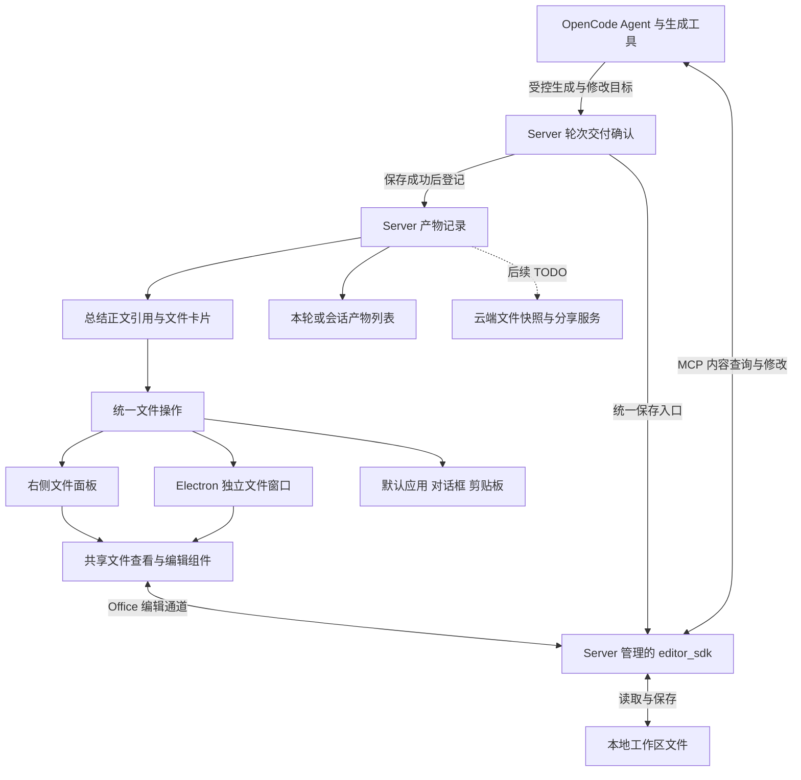
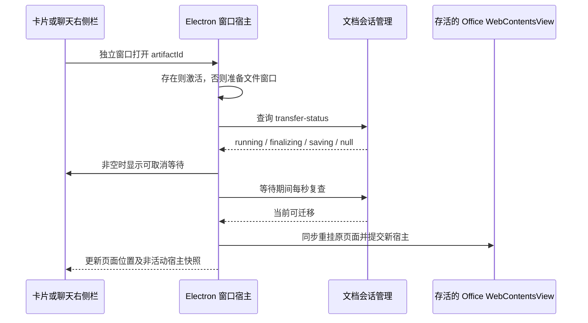

# JuggleWork 文件产物与 Office 编辑技术方案

状态：分阶段实施。目标范围：macOS 和 Windows 桌面端的本地工作区；当前 Word、CSV、Excel、PPT 原生编辑验证平台为 macOS ARM64 开发环境。文件产物展示覆盖已确认的生成文件，Office 编辑按格式逐步开放；分享链接和上传云端列为后续 TODO。

JuggleWork 将每轮任务生成或更新且已成功保存的交付文件汇总到该轮总结下。总结正文中的文件名提供可点击的文件入口；文件卡片展示类型图标、文件名、大小及操作。生成或确认交付只更新产物展示，不自动打开文件。点击正文文件引用、卡片主体或产物列表中的文件，才在右侧既有“文件”面板复用或新增文件 tab；点击卡片右侧“在独立窗口打开”图标，才打开独立文件窗口。Office 支持在这两个位置编辑；CSV、XLSX、PPTX 与 Word 使用同一套 Office 引擎及宿主生命周期；Markdown、TSV 和普通文本在两处共享文本草稿与保存状态。文件同时提供默认应用打开、添加到输入框、复制路径和另存为。

Word、Excel、PowerPoint 使用同一个本地文档引擎，Agent 与用户编辑同一份文档。产物记录、文件操作和编辑会话统一由本地 JuggleWork Server 管理，Electron 负责窗口和原生系统能力，React 负责展示。编辑器、正文链接、卡片和产物列表共用同一份文件身份与操作定义。

## 交付范围

| 能力 | 本期定义 |
| --- | --- |
| 每轮文件交付 | 宿主收集生成结果，轮次结束时先保存再确认交付，去重后统一展示，历史记录可恢复 |
| 正文文件入口 | 将总结中已确认存在的文件名渲染为文字超链接，统一链接色，无图标、底色或边框 |
| 文件卡片 | 图标、完整文件名、大小；右侧提供独立窗口、分享链接、更多操作 |
| 独立窗口 | JuggleWork 自己的文件窗口；各类型复用聊天右侧栏的文件视图；可编辑文件在两处具有相同编辑能力 |
| 更多操作 | 打开文件夹、在默认应用中打开、添加到对话框、复制路径、另存为；上传云端为 TODO |
| Office 编辑 | DOCX、CSV、XLSX、PPTX 共用原生编辑宿主，支持用户与 Agent 修改同一模型 |
| 分享链接和上传云端 | 云端分享入口保持禁用，服务端方案与实现在任务文档中列为 TODO，不生成伪链接；上传保持禁用 |

Markdown、TSV、图片、视频和 PDF 继续复用原有能力；CSV 使用 Office 原生表格编辑。不具备内置预览能力的文件仍有产物卡片、文件信息及默认应用打开入口。源码修改、依赖缓存、临时文件和只读引用的已有文件，不自动计为本轮交付产物。

### 当前实现边界

聊天右侧栏和独立文件浏览器中的 `.docx`、`.csv`、`.xlsx`、`.pptx` 使用本地 SDK 原生页面编辑，不经过 Blob 下载或前端重建 OOXML。Server 管理实际模型、保存、关闭和外部接管状态；Electron 保留页面存活，并将页面保存与 Cmd/Ctrl+S 接到同一保存入口。已有文件可以由用户打开，Agent 使用同一模型修改内容。30 秒自动保存和直接宿主 run 结束时的最终保存均已接入，最终交付等待模型保存成功。

本机真实 SDK 已验证中文页面输入、宿主按钮及 Cmd+S 保存、MCP 修改与轮次自动保存、外部接管后的新模型重新导入和取消关闭。macOS ARM64 开发桌面已验证 Word 在两处显式接续编辑；CSV 已通过真实 SDK 的导入、修改、UTF-8 原路径保存及重新导入验证；XLSX 两表与跨表公式、PPTX 多页文本和字体属性保存重开通过。对应格式均复用同一原生页面和模型；真实语言模型对话验收范围见 Agent 编辑章节。Office/WPS 复杂文档往返、Windows、正式打包和完全断网仍待验收。

现有语义工具提供所属聊天的 `office.current_document` 和 `office.save_document`，覆盖 DOCX、CSV、XLSX、PPTX。每轮系统提示按真实调用聊天重新查询文档状态、格式和模型 ID，查询失败明确为未知，不复用历史身份；原生创建/打开/关闭/保存工具受宿主管理。宿主新建 API 用于文件浏览器的手动新建 Word；不提供 Agent 新建文档动作。独立文件窗口已实现卡片快捷入口、多标签和存活页面迁移。指定 Logo 已接到窗口、Windows 任务栏独立分组及 macOS 文档 Dock 入口；macOS ARM64 开发宿主已验证入口进程注册及最后一个窗口关闭后的入口回收，Windows 实机与跨平台安装包验收仍待完成。队列 admission 已按真实引擎消息绑定交付；XLSX 和 PPTX 已接入相同原生宿主，复杂格式与跨平台安装包仍需单独验收。

CSV 点击正文引用、卡片或附件后，在右侧文件 tab 使用 `OfficeEditor` 加载同一 SDK 的 `/static/sheet/pc.html`，独立窗口使用相同原生页面与模型。保存、自动保存、关闭确认、外部应用交接及 Agent 内容修改复用 Word 的宿主流程，不使用 React 轻量表格编辑器或文本草稿写回 CSV。CSV 按 UTF-8 CSV 保存，保存前确认模型只有一个工作表；额外工作表须先移除后保存，避免静默丢失。CSV 仅持久化该格式支持的数据，不承诺保留 Excel 样式、多表与图表。TSV 继续使用轻量表格与共享文本草稿。

## 文档类型与交付范围

当前技术基线为 `@tencent/tencent-docs-ai-engine 0.2.196-wb`，配套 `editor_sdk 0.0.0.499`。引擎工具目录包含 70 个 `doc_*`、60 个 `sheet_*`、80 个 `slide_*` 工具，以及创建、打开、保存、查找等共享工具。工具存在与复杂文件兼容性分别验收。

| 类型 | 引擎能力 | 当前验证边界 | 产品交付范围 |
| --- | --- | --- | --- |
| Word `.docx` | 正文、段落样式、表格、图片、批注、页眉页脚、目录、公式等 | macOS ARM64 上已验证页面编辑、MCP 双向同步、标题与表格、保存重开 | 首个 Office 阶段开放基础编辑，其他能力逐项验收 |
| Excel `.xlsx` | 多工作表、单元格、公式、格式、筛选、排序、图表、透视表等 | 已验证 MCP 写入文本、数值与跨表公式、两张工作表保存重开；修改明细后公式结果保留 | 已接入原生表格页面和统一保存；普通多表及跨表公式通过真实 SDK 往返；含透视表或透视缓存的文件仅按原始字节只读预览 |
| PowerPoint `.pptx` | 页面、文本框、形状、图片、表格、图表、主题、备注、动画等 | 已验证多页文本框修改、宿主保存重开及未修改页保留 | 已接入原生幻灯片页面和统一保存；多页文本修改通过真实 SDK 往返；图片、基础动画与主题仅通过限定样例的结构核对，复杂对象和 Office/WPS 播放另行验收 |
| CSV | Office 原生表格编辑页面与模型 | 真实 SDK 已验证导入、单元格修改、UTF-8 CSV 原路径保存及重开 | 共用 Word 宿主，保存前限定单个工作表；不承诺 Excel 格式对象 |
| TSV | 轻量表格编辑器 | 共享文本草稿及保存已接入 | 不进入 SDK CSV 导入路径 |
| PDF | 包含预览资源 | 不计入 Office 编辑能力 | 保留现有 PDF 阅读方式 |
| `.doc`、`.xls`、`.ppt` 等旧格式 | SDK 扩展名表列出，但内核原生保存为 OOXML | 格式导入和转换尚需样本验收 | 后续提供兼容打开、另存为现代格式 |
| `.docm`、`.xlsm`、`.pptm` 等 | 扩展名表列出 | 宏执行及完整保留没有验证 | 首版不开放编辑，不承诺宏兼容 |
| ODT、ODS、ODP、Pages、Keynote | 不在该 SDK 当前扩展名清单中 | 不作为该引擎支持项 | 保留原有处理方式，不路由到腾讯引擎 |

macOS ARM64 开发桌面已验证 Excel 页面输入与 MCP 双向同步、两表保留及宿主保存重开；PPT 已验证原生页面加载、MCP 文本回显、页面字号修改回传模型和宿主保存重开。三种格式均需通过真实 Microsoft Office 或目标用户使用的 WPS 保存往返验收，ZIP 和 XML 可解析不足以证明完整兼容。全部功能离线使用、Windows 运行和复杂文档保真亦属于发布验收项。

## 现状与架构决策

JuggleWork 使用 Electron 44、React 19、TypeScript、Vite 和 OpenCode。`ArtifactList` 已展示本轮文件卡片、类型图标、大小及更多操作；文件在总结后统一呈现，正文中的已确认文件名在 Markdown token 层转为可点击引用。Server manifest 保留轮次快照，旧消息保留有限兼容解析。

产物类型已有 `document`、`sheet`、`slides`。DOCX、CSV、XLSX、PPTX 的文件 tab 及历史产物 tab 均使用 `OfficeEditor`，由统一格式契约决定 doc、sheet、slide 页面。旧二维字符串重建 `Sheet1` 的二进制保存路径已移除；旧格式和远程工作簿保留只读多表预览，不提供有损写回。TSV 保留轻量编辑路径。

遵循 `server-owned-runtime`：Server 管理产物元数据、文档引擎、实际端口、编辑会话和 MCP。Electron 管理聊天窗口、文件独立窗口、对话框、剪贴板及默认应用打开；独立窗口不创建第二个 Server、OpenCode 或文档引擎。



产物注册模块不依赖 Office 模块；Office 保存服务只报告结果并刷新文件元信息，交付协调模块调用保存服务后确认轮次产物。依赖方向为交付协调到 Office 服务和产物注册，不能由产物注册反向调用交付协调。窗口和面板通过统一操作层调用 Server，避免循环依赖。

## 总结正文与文件卡片

### 每轮交付的展示位置

以一次用户请求对应的完整任务轮次为单位，聚合该轮全部过程消息、工具结果和总结消息。文件卡片统一位于总结正文之后、该轮消息操作栏之前，不按每条 assistant 消息重复插入。模型结束输出不代表文件已完成交付；宿主仍在保存时显示“正在保存文件”，保存成功才展示对应完成卡片，失败显示该文件的失败状态与重试入口。

即使总结没有再次写出文件名，只要该轮已确认交付文件，仍显示卡片。该轮没有交付文件时不显示空列表；同一文件在该轮多次保存只显示一张卡片。后续轮次修改同一文件时，在后续轮次显示“已更新”的交付记录，历史轮次保留自己的交付快照。

总结正文的文件引用和下方卡片可以同时出现：前者帮助阅读，后者承载大小与操作。异步图片、视频等任务完成后更新其所属原始轮次，不挂到当前正在进行的其他轮次；同一产物不得被专用媒体结果组件和通用卡片重复列为两份交付。

### 正文文件引用

已确认的文件名仅显示文字超链接，与普通网址统一使用主题链接色，不带下划线、背景、边框、类型图标或下拉按钮；链接标签内的行内代码也不添加底色。文件类型图标保留在下方产物卡片。点击文件链接在右侧既有“文件”面板打开，相同路径复用已有 tab。DOCX、CSV、XLSX、PPTX 两处显示同一文档，未持有原生编辑页面的一侧展示当前页面快照，点击内容区接续同一页面的编辑，不要求返回聊天窗口。TSV、Markdown 和文本直接共享同一份草稿。

渲染规则：

- 已有 Markdown 文件链接保留标签文字，目标解析到同一 `artifactId` 后使用统一文件操作。
- 纯文本和行内代码中的文件名，在本轮文件候选中通过 Server 确认存在且唯一匹配时转为文件引用；DOCX、CSV、XLSX、PPTX 使用相同规则，支持中文文件名及引号或行内代码包裹的带空格路径。普通“文件：xxx.pptx”和只读核对不要求出现“生成/保存”等交付措辞；引用不依赖交付快照是否已有记录，也不把引用自动登记为本轮交付。路径可以精确匹配，单独文件名必须无歧义，大小写不同的路径保持独立身份。
- 存在同名不同目录文件时不按后缀或模糊匹配猜测；使用带目录的引用或下方卡片区分。
- 代码块、外部网址、普通句子中的相似文字、未确认存在的文件，不批量替换成链接。
- 该转换发生在 Markdown 的 token 或语义节点层，不对整段 HTML 做字符串替换，也不修改存储的原始消息文本。
- 缺失文件保留可读文件名和不可用提示，不伪造可打开链接。历史总结只使用所属轮次提及且已确认存在的文件，不套用整个会话的文件集合。

模型可以输出文件 Markdown 链接，但文件是否可点击由实际文件存在性决定，是否出现卡片由本轮交付数据决定，不依赖模型遵守固定话术。

### 卡片视觉与交互

```text
[文件类型图标]  项目方案.docx                 [独立窗口] [分享] [更多]
                13 KB

查看所有产物（N） ›
```

卡片采用横向布局、圆角和主题适配的浅色背景。左侧为文件类型图标，中间第一行为实际文件名及扩展名，第二行为大小；右侧依次为独立窗口、生成分享链接、更多操作。Word、Excel、PPT、PDF 和通用文件使用项目自有图标与类型配色，不依赖系统文件图标才能正确显示。

文件名保留完整可访问文本，窄屏使用省略号和悬浮提示，不能只显示固定 20 个字符。大小来自文件系统 `stat.size`，使用现有 `formatFileSize`；0 字节是有效大小，未知大小不能显示成 0。卡片对应完成交付时的文件快照，打开前再确认当前文件状态。

点击卡片主体或文件名在右侧“文件”面板打开；点击右侧独立窗口图标只执行独立窗口操作，不触发右侧面板打开。工具提示和可访问名称统一为“在独立窗口打开”。生成结束、交付轮询、历史消息恢复及产物列表刷新不得触发任一打开动作。按钮具备键盘焦点，窄屏可把快捷操作收进更多菜单。列表纵向排列，不以横向滚动作为查看全部文件的唯一方式。卡片与总结正文、查看所有产物入口保持紧凑间距。

一个轮次提供“查看所有产物（N）”入口，打开统一产物列表并默认筛选当前轮次；列表可以切换为当前会话全部产物。计数与卡片使用相同数据源。卡片按本轮首次交付顺序稳定排列，更新不重新跳位；超过 3 个文件时总结默认显示前 3 个，列表中查看其余文件。会话全部产物按 `artifactId` 去重，显示当前文件元信息；轮次筛选显示该轮交付快照，两种范围明确标注。

### 文件操作定义

| 位置 | 操作 | 行为及状态 |
| --- | --- | --- |
| 卡片主体、正文引用 | 打开 | 在聊天右侧栏的文件 tab 打开，同一文件与文件浏览器共享内容及编辑能力 |
| 右侧快捷按钮 | 独立窗口打开 | Office 迁移现有视图或首次在新窗口打开；非 Office 预览已保存版本；重复点击激活既有窗口 |
| 右侧快捷按钮 | 云端分享 | 未接入服务端时禁用并提示“分享暂未开放”；TODO 仅记录在任务文档中 |
| 更多菜单第一组 | 打开文件夹 | 调用已有系统文件定位能力，打开所在目录并尽可能选中文件 |
| 更多菜单第一组 | 在默认应用中打开 | 保存后交出编辑权，Office 释放引擎模型，再调用系统关联应用 |
| 更多菜单第二组 | 添加到对话框 | 将文件作为附件或文件引用加入该卡片所属聊天的输入框，去重；不自动发送消息 |
| 更多菜单第二组 | 复制路径 | 复制当前实际绝对路径；成功后给出轻量反馈 |
| 更多菜单第三组 | 另存为 | 打开原生保存对话框，将已保存文件导出为副本；不改变当前编辑文件身份 |
| 更多菜单第四组 | 上传到云端 | 后续 TODO；未配置云端能力时禁用，不展示可用的虚构云盘子菜单 |

菜单分组和快捷按钮使用同一组动作定义。未开放、文件缺失、正在迁移等情况由能力状态统一控制，不让正文、卡片、面板和独立窗口出现相互矛盾的可用状态。

“添加到对话框”使用现有附件管线；文件尚有未保存内容时先由所属编辑器保存，保存失败则不添加过时附件。默认应用打开、另存为和未来上传/分享同样先处理未保存内容；外部应用接管期间，附件和副本使用明确标注的当前磁盘版本。另存为完成提示副本位置，原卡片与当前编辑器仍指向原文件；用户导出的副本不自动冒充本轮 Agent 新生成的交付。

## 产物来源与每轮归属

### 输入栏与消息附件

输入栏粘贴、拖入或选择的 Word、Excel 等文件卡片可点击，点击后在所属会话右侧复用或新增文件 tab，不发送消息、不自动打开独立窗口。图片继续使用原有灯箱预览。移除按钮独立操作，不触发文件打开。

首次点击文件附件时通过现有 inbox 接口建立工作区副本，路径按会话及附件身份区分，重复文件名不相互覆盖。附件保留 `workspaceCopy`，后续点击与发送复用同一文件，已保存的编辑不被原始上传字节覆盖；切换工作区时重新建立副本。消息发送后的 `file://` 附件解析为服务端确认的工作区文件；旧消息内嵌 data/blob 附件点击时建立副本后使用相同右侧入口。附件不作为 Agent 生成产物。

本机 XLSX 使用 SDK 的原生表格页面和完整工作簿模型。`WorkbookFileView` 保留用于旧格式及远程工作簿的只读预览，支持工作表切换、格式化值及公式缓存，无缓存时显示公式文本，不提供写回。桌面 HTTP 桥按 ArrayBuffer 传递响应，避免二进制内容被 UTF-8 文本解码破坏。

### 文件交付的判定

产物是本轮明确交付、已成功落盘并可由宿主确认的文件。产物路径可以位于工作区任意合法目录，不能只列某个固定输出文件夹。

按以下入口收集候选并统一确认：

1. Office 创建和保存、现有媒体生成完成等宿主管理操作，记录结构化文件目标及所属任务轮次。创建阶段的空白文件仅是候选，不代表最终内容交付完成。
2. 已知写文件、编辑、补丁和导出工具，从工具参数、成功结果及交付声明收集目标。源码修改不默认作为交付卡片。
3. Shell、Python 文件生成使用新增语义动作 `artifact.generate_files`，复用现有工具执行与权限管线。宿主在启动前绑定原始轮次，为该次生成分配专用输出目录并设置 `JUGGLEWORK_ARTIFACT_DIR`；生成进程默认在该目录运行。结束后宿主自动枚举该目录的交付文件，或确认启动前声明的工作区输出路径，不依赖 stdout、总结文字或 Agent 再调用注册动作。
4. 旧工具和旧消息中的文件路径仅作为候选，再通过已有路径解析和 `stat` 确认。仅当能关联到本轮成功写入或明确交付结果时纳入本轮；不把“讨论过一个已存在文件”当成生成文件。

专用输出目录只放交付文件，脚本、缓存和中间文件使用独立临时目录。生成进程成功退出并结束写入后才确认输出；失败进程的残留文件不自动发布为完成产物。工作区其他位置也可交付，但应在生成调用的 `outputs` 中声明实际路径。普通 Shell 命令在任意目录静默写入且没有结构化目标时，无法可靠判定交付；文件生成入口必须使用上述受控契约，`artifact.register_outputs` 仅补充已有工具或用户明确指定的文件。

`artifact.generate_files` 由引擎工具 `jugglework_artifact_generate` 承载，接收 `program、args、outputs?、timeoutMs?`，复用实际工具上下文的 `ask` Bash 权限和取消信号，以参数数组启动程序，不隐式拼接 Shell。输出目录为 `artifacts/generated/<generationId>`，通过 `JUGGLEWORK_ARTIFACT_DIR` 和进程工作目录传入；临时目录单独分配。补充登记工具为 `jugglework_artifact_register`。缺少真实归属或权限上下文时拒绝执行，不静默绕过。

不通过扫描整个工作区近期修改文件来猜测产物，也不依靠总结中恰好出现文件名作为唯一来源。运行中收集候选，确认交付时批量刷新真实文件名、类型、大小和时间；Office 交付在最终内容保存成功后才进入 ready 列表。

Agent 调用创建和保存时，轮次身份由当前执行请求派生，不能由模型任意选择其他历史轮次。用户手工保存仅刷新当前文件元信息，不被登记成另一次 Agent 交付；用户导出副本也不自动修改历史轮次列表。

生成失败、文件不存在、内容仍在写入或保存失败时，不显示“已生成”的完成卡片。保存失败提供对应文件的重试提示；完成轮次只发布已保存成功的产物。工具失败之前已经成功交付的其他文件仍保留。

### 轮次结束的交付确认

OpenCode 的模型运行状态与宿主的文件交付状态分别记录，不篡改上游任务结束事件。文件交付状态为 `collecting / finalizing / ready / partial / failed`：模型运行结束后进入 finalizing；仍有后台目标 pending 时保持 finalizing 并显示“后台生成中”，已有成功文件可先展示。所有目标都有结果后，全部成功为 ready，部分成功为 partial，全部失败为 failed。没有产物的轮次不展示文件交付区。

宿主按固定顺序完成确认：

1. 停止接收已结束运行的新文件修改，等待其正在执行的受控生成、写入及 Office 工具调用结束。
2. 保存本轮 Agent 实际修改过的 Office 文档，不保存其他聊天的无关文档；所有调用经过统一保存入口。只创建了空白磁盘文件、随后在内存中修改，也必须再次保存。
3. 校验生成输出和保存结果，再登记 `TurnArtifact` 快照并通知界面完成。不能以模型回复、已有文件或 30 秒自动保存作为交付成功依据。
4. 保存失败保留 dirty 与待确认记录，标注具体失败文件；已成功文件正常显示。重试只重做未完成目标，成功后更新同一轮记录，不重复生成文件或卡片。

运行开始前保存 `workspaceId + sessionId + turnId + runId` 归属，工具执行记录、Office 修改目标和媒体 job 均沿用这份归属。后台长任务在提交时标记 pending，不阻塞聊天等待其全部完成；最终回调更新原始轮次的同一交付记录，不误挂到当前轮次。宿主重启后未确认记录保留为待检查状态，重新确认磁盘结果，不自动重放生成命令。

### 轮次与持久化

使用真实引擎用户消息 ID 作为 `turnId`，直接执行批次使用现有宿主 `runId`，admission 批次沿用稳定的引擎请求身份，不按最后一条 assistant 消息猜测归属。重试或事件重放对同轮同产物执行 upsert，去重键为 `turnId + artifactId`。文件大小等由 Server 批量返回，避免每张卡片独立发起查询。

直接启动使用真正传给引擎的 `messageID` 绑定轮次，工具和媒体提交按实际 assistant 消息的 `parentID` 查找原始归属。`local-queue`、`local-steer`、`remote-pending` 在提交 admission 前使用既有确定性映射生成的真实引擎用户消息 ID 绑定轮次，交付批次记为 `admission:<messageId>`，不创建额外宿主 run。工具、受控生成、Office 修改与媒体任务按 assistant 的真实 `parentID` 查找该归属，重试和重启沿用同一记录。只有引擎空闲、该轮存在已完成 assistant 消息且没有未完成工具时，才结束交付收集并执行最终保存确认；排队回执或尚未执行的空闲快照不能提前结束该轮。没有历史绑定记录的旧消息继续使用兼容展示。

产物登记使用工作区现有本地持久化目录，初版在 `.opencode/jugglework/artifacts/manifest.json` 保存版本化记录，包括运行归属、待确认目标、后台任务引用、交付状态及文件快照；常驻 Server 为唯一写入方，内存 Map 缓存，以临时文件和 rename 写入，不新增数据库表或跨进程锁。Office 引擎会话仍仅保存在内存。

历史消息重新打开时按轮次加载记录。已有历史任务没有记录时，使用原有提取逻辑做有限兼容，能够确认的文件提供卡片，不虚构原始生成时的大小。文件后续被删除时显示“文件已不存在”；后续有更新时保留交付快照并提示“文件已有更新”，操作指向当前实际文件。重命名经宿主更新稳定身份；无法确认的外部移动不根据同名文件自动重绑定。

## 文件与编辑会话的数据模型

```typescript
/** 可交付文件的稳定身份；实际文件名与路径由宿主确认。 */
interface FileArtifact {
  artifactId: string;
  workspaceId: string;
  relativePath: string;
  name: string;
  kind: string;
  mimeType: string;
  sizeBytes: number | null;
  updatedAt: number | null;
  exists: boolean;
  editingOwner: "internal" | "external";
}

/** 一轮任务对文件的交付记录，快照用于历史总结展示。 */
interface TurnArtifact {
  turnId: string;
  sessionId: string;
  artifactId: string;
  source: "runtime" | "history";
  snapshot: { name: string; sizeBytes: number | null; updatedAt: number | null };
}

/** 宿主维护的轮次交付状态，与模型运行状态分别更新。 */
interface TurnDelivery {
  turnId: string;
  sessionId: string;
  runIds: string[];
  finishedRunIds: string[];
  status: "collecting" | "finalizing" | "ready" | "partial" | "failed";
  targets: Array<{
    key: string;
    runId: string;
    path: string | null;
    source: "tool" | "generation" | "media" | "office";
    status: "pending" | "ready" | "failed";
    artifactId?: string;
    jobId?: string;
    outputDirectory?: string;
    outputs?: string[];
    error?: string;
    retryable?: boolean;
  }>;
  items: TurnArtifact[];
}

/** Server 的 Office 会话；窗口位置和 WebContentsView 由 Electron 单独管理。 */
interface OfficeDocumentSession {
  documentId: string;
  pageId: string;
  artifactId: string;
  workspaceId: string;
  ownerSessionId: string;
  relativePath: string;
  name: string;
  state: "opening" | "ready" | "saving" | "external" | "error" | "closed";
  engineFileId: string | null;
  previewUrl: string | null;
  dirty: boolean;
  savedAt: number | null;
  error?: string;
}

/** 原生选区内容只作数据；页面 fileId 和 aiPrompt 不进入编辑目标。 */
interface OfficeSelection {
  kind: "doc" | "sheet" | "slide";
  data: Record<string, unknown>;
  capturedAt: number;
}
```

`artifactId` 识别文件，`turnId` 识别交付轮次，`documentId` 识别宿主编辑会话，`pageId` 识别当前页面代次并在恢复后更换，`engineFileId` 识别当前引擎实例中的模型，`windowId` 识别 Electron 视图。卡片不能把文件路径或引擎 UUID 当成聊天轮次。

从文件浏览器打开一个尚未登记的已有文件时，先解析并建立 `FileArtifact` 身份，再进入统一打开流程，不为它补写虚假的生成轮次。`FileArtifact` 可以独立存在，只有实际交付时才关联 `TurnArtifact`。

路径沿用 Server 工作区解析规则，处理 Windows 盘符、中文、空格、分隔符与符号链接。POSIX 路径不统一转小写。一个实际路径只建立一份编辑会话；其他聊天请求编辑同一文件时激活既有视图及其所属会话，避免隐式改变 Agent 的文件目标。

所有入口在打开和操作前查询统一能力：内置预览、内置编辑、首次独立窗口打开、保持状态迁移、默认应用、附件、另存为及分享是否可用。类型图标与打开方式分开决定，不能因为 `.pptx` 有 PPT 图标就宣称其编辑能力已交付。文件浏览器与侧栏使用相同格式能力；文本与 TSV 共用一份草稿，DOCX、CSV、XLSX、PPTX 共用各自唯一的原生模型，不创建互不相干的保存版本。

## 右侧面板与独立窗口

### 共享文件视图

独立窗口按钮以主进程实际注册的 `jugglework:file-window:available` 能力为准。preload 中存在 `fileWindow.open` 方法不代表正在运行的主进程已支持该方法。开发时更新 Electron 主进程或 preload 必须重启桌面应用；Vite 热更新只能更新界面。旧主进程或旧 preload 下保持普通文件预览可用，独立窗口入口禁用并提示重启，不展示原始“No handler registered”错误。

文件浏览器与聊天右侧栏共同使用 `FileViewer`，复用相同的类型分流、预览、编辑按钮、错误提示和保存定义。独立窗口由 Electron 的 `BrowserWindow` 承载，加载 JuggleWork 自己的文件路由和最小 preload；不把带宿主能力的窗口直接导航到任意文件内容或外部网页。

Office 编辑页面由独立的 `WebContentsView` 承载，Electron 管理其位置、尺寸及窗口归属，React 容器提供挂载区域与工具栏。聊天右侧栏和文件窗口之间移动同一个 view，不因 React 组件卸载而销毁页面。图片、PDF 等继续使用既有查看器；尚无内置查看器的文件显示文件信息及默认应用入口。`.xlsx` 原生编辑未开放或 SDK 不可用时显示文件信息和外部打开入口，不能以旧单表编辑器作为可写回退。

文件浏览器是独立的文件编辑窗口，显示文件名、保存状态和文件操作，不提供“返回主窗口”动作。聊天窗口可以继续使用，右侧栏提供相同编辑能力。窗口使用相同本地 Server 和工作区，引导只携带必要身份，不把凭据写入页面 URL；沿用现有桌面桥边界，不新建认证体系。Office 窗口内的 `Cmd+S` / `Ctrl+S` 和 `Cmd+W` / 关闭按钮只作用于该窗口的文件。

窗口顶部为文件标签、关闭按钮与添加菜单，下一行为文件名、保存状态、保存和更多操作。添加菜单提供新建 Word、打开工作区文件和最近文件；更多菜单提供打开文件夹和另存为。分享与上传维持禁用。原生 Office 页面在菜单展开时暂时从宿主移出并显示快照，菜单收起后挂回同一页面，避免遮挡菜单或抢占焦点。

右侧 Office 编辑面板和独立文件窗口共用 `FileEditorToolbar`。顶栏左侧显示完整文件名的截断文本与原名提示，以及“已保存 / 未保存 / 保存中”状态；已保存使用勾选图标，未保存使用时钟图标，导入及保存中显示转动图标。加载、故障和外部接管状态不能显示为已保存。右侧依次显示保存、上传、分享及更多图标，只有存在可保存修改时保存按钮才可用。右侧面板在文件名旁提供打开文件夹入口，更多菜单包含在独立窗口打开、打开文件夹和另存为；独立窗口更多菜单保留后两项。两种宿主沿用各自已有文件操作与保存管线，云端能力未接入前保持禁用。

### 独立窗口 Logo 与任务栏

独立窗口统一命名为 **JuggleWork 文件浏览器**，原生窗口标题、HTML 标题、macOS Dock 名称和 Windows 任务栏显示名称保持一致，不使用 Word Preview 等测试名称。文件名显示在窗口内部的标签和内容标题中，Dock 文档列表使用当前文件名区分多个窗口。

用户指定的原始 Logo 保存在 `apps/app/public/file-window-logo.png`，用于窗口图标和文档界面标识。Windows 在窗口显示前生成配套 ICO，并设置文档窗口专属 AppUserModelID `com.juggleai.jugglework.documents`，使任务栏使用文档图标和分组，主应用标识保持原值。

macOS Dock 按应用进程显示图标。`JuggleWork File Browser.app` 是轻量 AppKit 文档入口，使用同一 Logo 生成 ICNS，随应用本地构建、签名并打包。它不运行文档引擎、不持有编辑模型；通过父子进程管道接收窗口 ID/标题，点击 Dock 入口或选择 Dock 菜单中的文档时激活已有 Electron 文件窗口。编辑窗口仍由主 Electron 进程承载，系统窗口归属与 Exposé 仍属于主进程，Dock 菜单提供明确的文档列表。

存在独立文档窗口时启动入口，最后一个窗口关闭或应用退出时回收入口；父进程异常退出导致管道关闭时入口自行退出。入口的“退出”先交由原窗口逐个确认保存、放弃或取消，取消或保存失败不提前消失。应用整体退出与更新重启在所有文档确认完成后销毁文件窗口，再停止 Server，避免服务停止后再次触发窗口保存。该入口不替换主应用 Dock 图标，不产生第二个 Server 或编辑器实例。

### 文本与表格的共享编辑

DOCX、CSV、XLSX、PPTX 在文件浏览器与聊天右侧栏中使用同一个 `OfficeEditor`，按格式加载 SDK 的 Word、表格或幻灯片页面，共享原生模型与未保存状态；两处通过存活页面交接继续编辑。TSV、Markdown 和普通文本使用 `FileViewer` 的文本路径，TSV 直接修改单元格，Markdown 可切换预览与源码编辑，文本直接编辑，两处共享同一文本草稿。图片、PDF、HTML 和暂不支持编辑的二进制文件保持对应预览能力。

Electron 的 `file-editor.mjs` 按 `workspaceId + path` 持有唯一文本草稿、磁盘时间基准和最近保存结果。两种渲染宿主通过 `fileEditor.state/update/onChanged` 获取和同步内容，React 文件面板 store 作为当前视图的镜像。打开另一处视图直接取得共享草稿，无需先保存、导出或重新打开。编辑模式、选区和文本编辑器各自的撤销栈属于视图状态，Office 的原生撤销记录由存活页面保留。

按钮和 Cmd/Ctrl+S 调用 `fileEditor.save`，通过已有 `/files/raw` 写回路径和时间基准。保存成功广播实际内容与新时间，所有打开视图更新已保存版本并清除对应草稿；保存失败或磁盘冲突保留草稿，不强制覆盖。保存期间的新输入继续保持 dirty，沿用新的磁盘基准等待下次保存，无需引入复杂锁。

关闭标签、文件浏览器或应用时，共用保存、放弃和取消确认。取消或保存失败保留视图与内容，确认完成后才销毁窗口和停止本地服务。添加附件、导出副本和默认应用打开使用同一草稿准备入口，取消或失败不继续后续操作。默认应用接管标记同步到两种视图，明确重新载入后才恢复内部写入。

### Office 视图迁移

首次打开 Office 页面与迁移已打开页面分别控制：首次打开沿用实际平台、SDK 配套版本和本地资源校验；已有存活页面的跨窗口迁移当前仅开放 macOS ARM64。Windows、macOS Intel 及其他平台在迁移前提示先保存关闭再在目标窗口重开，不触发自动保存、不销毁或重新导入模型。独立窗口图标、内容区接续及直接页面分配使用相同边界；未成功迁移的新建空窗口被清理，源页面、dirty 内容和归属保持不变。模拟平台回归覆盖 DOCX、CSV、XLSX、PPTX 及双向入口，不代表目标平台实际渲染、输入法或任务栏验收通过。

同一 Office 文档只有一个可写页面与一份引擎模型。迁移保持 `WebContentsView`、页面、`engineFileId` 和引擎模型存活，仅变更其 Electron 窗口归属；不采用关闭模型再重开的方式模拟迁移。



Office 窗口宿主复用现有浏览器面板保留 `WebContentsView` 的实现模式，跨窗口重挂载保持同一页面与模型；macOS ARM64 开发桌面已验证双向交接。正式发布前，仍需在目标平台完整验证页面通信、输入法、选区、撤销/重做以及 Agent 编辑历史持续有效。

文件窗口页面准备成功后才接收文档；重挂成功后才提交宿主归属并广播位置。挂载失败时恢复原宿主的挂载和可见性，保留页面、dirty 内容及模型。窗口页面准备失败时销毁空窗口，原编辑页面保持可用。上述失败回退已通过宿主边界测试。运行中等待与取消由同一宿主迁移入口实现，macOS ARM64 隔离验收窗口已验证取消保留原页面和任务完成后继续迁移。

文件接口在重命名、覆盖或删除前检查存活 Office 模型，涵盖源文件、目标文件及父目录。模型处于 opening、ready、saving 或 error 时均拒绝该操作，提示先保存关闭；不自动关闭重开，也不在模型存活时修改绑定路径。关闭后重命名同步产物身份，再次打开使用新路径。关闭、外部接管、导出准备和故障恢复共用所属聊天的宿主运行、实际引擎活动及当前文档交付检查；查询失败不视为空闲。

引擎意外退出后，Server 将文档置为 error 并清除原生模型身份及页面地址；退出前尚未结束的就绪查询或保存响应不能恢复旧状态，也不能确认该次交付。两处编辑容器隐藏旧页面并显示“重新打开已保存版本”。点击后由原生对话框确认未保存修改及撤销记录会丢失，取消不改变原状态；当前聊天任务执行中拒绝恢复。确认后等待旧保存请求结束，释放残留模型，从原文件重新导入，保留 documentId、所属聊天及文件标签，并向两个宿主同步恢复结果。重新导入仍须通过格式对应的内容查询才能 ready；恢复不生成新产物。macOS ARM64 真实 SDK 的受控 CSV 意外退出、未保存内容丢弃及磁盘版本恢复已验证，macOS ARM64 隔离宿主已验证实际 Word 页面崩溃后两处同步故障、恢复取消和确认、保留文档标签身份、恢复磁盘已保存内容及继续编辑保存。Word 复杂文档和其他平台故障行为仍待完整验收。

文档关联的 Agent 运行或交付确认尚未结束时，迁移动作显示等待状态，允许取消，不在连续编辑步骤之间销毁模型或改变绑定。宿主通过 `office.transfer` 查询 Server 的 `transfer-status`：依次检查所属聊天的宿主运行、引擎活动、当前文档待确认交付及正在执行的保存。状态未知或请求失败时不迁移；等待期间每秒复查，取消会中止查询并清理尚未接收文件的空窗口。首次打开没有现有原生页时不进行迁移等待，不引入新的锁或持久化移动状态。窗口准备或挂载失败时将同一个 view 留在或挂回原宿主；模型仍存活时不重开替代。原生页面崩溃或加载失败时，Electron 向 Server 上报该文档故障并同步两种宿主，释放页面协议处理器；不影响其他文档，残留模型仅在用户确认恢复后释放。旧页面事件及晚到保存不能改回 ready。页面或引擎实际崩溃按故障恢复处理，明确只恢复最后保存版本，清空失效 ID，不承诺保留崩溃前的撤销记录。

macOS ARM64 隔离验收宿主已验证 Word 的文字选区和用户/MCP 编辑记录在双向交接后保留：页面撤销依次撤销 AI 插入和用户输入，重做可恢复两者；迁移后仍可读取同一 AI 编辑历史，并对尚未被覆盖的版本执行 `doc_undo_ai_edit`。界面撤销并重做会生成后续 revision，SDK 可能拒绝对已被覆盖的原 AI 版本再执行按版本反向撤销；此时保留失败结果，不猜测其他版本，也不以删除相似文本代替撤销。Cmd/Ctrl+O 在当前宿主弹出工作区文件选择器：主窗口打开右侧文件标签，独立窗口复用窗口内标签，取消保持原文档。原生编辑区及文件窗口在输入法组合中不接管保存、关闭或打开快捷键；macOS ARM64 开发桌面的 Word 侧栏与独立窗口已验证真实拼音组合、中文上屏及上屏后 Cmd+S 保存；组合期间 Cmd+O 不弹文件选择器，独立窗口的 Cmd+W 不关闭文档、Cmd+S 不接管组合输入。Windows、其他格式的中文输入法仍待验收。

同一 DOCX、CSV、XLSX 或 PPTX 在文件浏览器与右侧栏打开时，两处均显示文档内容。当前编辑的一侧持有原生页面；另一侧每秒获取该页面快照，点击“点击编辑文档”后将同一页面挂载到当前内容区。后台尺寸刷新不能抢占编辑焦点，文档、页面和模型 ID 保持不变。界面不显示“返回主窗口”或要求用户到另一处编辑的限制。

按平台分别控制首次独立打开与视图迁移能力。尚未通过保持状态迁移验收的平台，可以首次在独立窗口打开文件；已有编辑视图的迁移按钮禁用，提示“请先保存并关闭当前文档，再在独立窗口打开”。用户明确关闭再打开属于新会话，会重置撤销历史和选区；不能把这一过程自动作为迁移回退。

关闭独立 Office 窗口前先等待关联 Agent 运行及交付确认结束，或由用户取消该运行并等待当前调用退出，再执行统一 dirty 处理；保存成功或明确放弃后才结束编辑会话。聊天右侧栏恢复为可重新打开状态，产物卡片保留。聊天窗口关闭遵循应用既有退出策略；实际退出前先处理所有 Office 窗口和非 Office 聊天右侧栏草稿，取消或保存失败则中止退出，确认后才停止 Server 和引擎。

## Office 打开与 Agent 实时编辑

每个本地 Server 实例管理一个 `editor_sdk`。启动前向系统申请空闲端口，避免原生进程快速退出后固定端口扫描连续绑定失败；wrapper 确认最终实际端口，预览地址和宿主 MCP 连接均从该结果生成。本地工作区首次启用 Office 功能时后台启动并连接实际 MCP 地址，成功后才声明工具可用；引擎失败不阻塞普通聊天任务。

文件浏览器的手动新建 Word 调用宿主创建接口：创建空白文档、等待就绪、保存到用户选择的工作区路径并释放临时模型，再由页面建立编辑会话。已有文件直接交给页面打开，不提前通过 MCP 再打开一次。Agent 仅查询、编辑和保存已打开的文档，不增加新建文档动作。

该 Word 版本在“先 MCP 打开，再由页面 OpenWith 复用”顺序下出现过页面模型失效及提交 404。首版采用页面建立主会话的时序；查询真实 `engineFileId` 后，通过 Word 位置查询、Excel 子表查询、PPT 元信息的 `is_open=true` 确认模型 ready，不能以页面 load 或创建工具返回代表导入结束。

预览地址由配套 wrapper 生成：

| 类型 | 页面与配套模式 |
| --- | --- |
| Word | `/static/doc/pc.html`，`sdk_local` 与本地引擎地址 |
| Excel | `/static/sheet/pc.html`，`sdk_local_pure` |
| PPT | `/static/slide/pc.html`，`sdk_local_wb` |

Office 在通用下载和 Blob URL 管线之前分流，直接使用工作区实际路径。现有 HTML 预览保留原有 CSP、sandbox；Office 使用独立容器适配所需能力，不全局关闭 Electron `webSecurity`。语言、主题、剪贴板、页面保存和各格式的宿主事件逐项验收。

原生 HTTP MCP 由 Server 内部连接，不向 OpenCode 注册完整的 Office 工具目录。当前 SDK 包含 219 个工具，完整目录约 38 万字符；模型只通过现有语义工具按需发现和执行当前格式的内容能力，无需额外 MCP 转发服务。

`jugglework_query` 的 `office.tools` 不传 name 时仅返回当前格式可用工具的名称与说明；指定 name 时返回单个工具的原始 inputSchema。模型读取参数后，通过 `jugglework_execute` 的 `office.call` 调用该工具。工具目录随引擎进程重启清理，不复用旧版本目录。实际调用工作目录优先于仓库根目录，用于多工作区匹配。

复用现有 `jugglework_context`、`jugglework_query`、`jugglework_execute`。共享资源类型增加 `artifact`，发布文件身份、当前 viewHost、windowId 及编辑状态；side-panel 仅引用相同资源。独立窗口中的文档不依赖 `sidePanel.open=true` 才能被 Agent 读取。提示词按当前请求所属聊天注入文档摘要，不把全局焦点文件套给其他聊天。

宿主内容调用沿用统一的执行前后校验进行业务目标校验和修改登记，缺失 `file_id` 时填入该聊天当前 ready 文档的实际 ID，显式 ID 不匹配时拒绝错误目标。原生创建、打开、关闭、shutdown 由宿主控制，通过已有工具策略禁止 Agent 绕开视图管理。原生 `save_file` 同样禁止 Agent 直接调用；正文查询和修改通过 office.call 由宿主调用引擎工具。Agent 使用新增语义动作 `office.save_document` 调用统一宿主保存入口，只接收当前文档身份，不接受 `file_path`、输出格式或其他目标路径。生成副本通过单独的宿主导出动作处理，不能借保存绕开文件身份和元信息更新。

修改工具成功后，宿主记录本轮触及的文档并刷新 dirty 状态，供最终交付确认使用。原生查询不得被误记为文件修改。Word 坐标来自查询或上次编辑结果；Excel 使用实际子表 ID，区分文本、数值与公式；PPT 查询实际页面与形状 ID。保持存活的视图迁移不更换 ID；关闭重开和引擎重启后重新查询全部模型与对象 ID。页面打开期间不使用外部脚本覆写同一磁盘文件。

Agent 指引按格式使用 `doc_*`、`sheet_*`、`slide_*` 内容工具。CSV 删除第一行使用实际工作表的 `sheet_delete_dimension`，参数为 `dimension_type: "row", index: 0, count: 1`；明确保留表头并删除首条数据时使用 `index: 1`。保存调用 `office.save_document`，成功后才能说明已保存；不提供 Agent 新建文档动作。

每轮上下文仅提供当前文档的 documentId、相对路径、类型、state、ready 时的 engineFileId、dirty 和可用选区，省略预览地址。调用身份来自本轮顶层 sessionID 或本轮 context；插件初始化身份不能代替缺失的本轮聊天。`office.current_document` 可在后续工具步骤重新查询。用户明确指定其他文件时不能改写当前文档代替。

选区通过已有本地桌面桥按需读取。每次 Agent 上下文或 `office.current_document` 查询时，Server 先确定所属聊天的当前文档，再以 workspaceId、documentId、pageId 请求该文档的可见存活页面；读取前后核对页面和模型身份。页面自带 fileId、标题和提示词不参与目标选择。不缓存通知坐标，不依赖全局窗口焦点；未知契约、读取超时、隐藏、切换、关闭或恢复后返回 null，Agent 需要选区时应要求明确范围。纯引擎宿主没有桌面选区。

页面适配绑定 SDK 0.0.0.499：Word 从 `pad.editor` 读取连续 begin/end/length 字符范围；CSV/XLSX 从 `SpreadsheetApp` 读取当前子表与行列范围，整行/整列末端按当前模型网格限制；PPT 从自身 selectionService 读取 pageIndex 和 shapeIds；普通单个文本形状处于编辑状态时，读取真实 anchor/focus，转换为 textSelection（shapeId、start、count、可选 selectedText）。位置按 UTF-16 码元计数，跨段落计入一个 `\r`，支持反向选择及折叠光标。Word 跨单元格、表格浮动对象以及 PPT 备注、框选和组内选择尚未适配，返回 null；只有普通单个文本形状的有效 textSelection 代表内部文字范围；其他形状身份不能代替文字范围，编辑中的非法坐标返回 null。当前 SDK 可用 `slide_set_text_property` 精确修改范围格式；整框替换工具会重建字符样式，不能宣称是保留其他格式的局部文字替换。配套 SDK 的 MobX 数组先通过 slice 转为普通值数组再解析。只读这些状态，不触发内部 AI 浮层，不模拟点击或改变焦点。原通知 preload、环境开关和 IPC 已移除，Server 不保存历史选区。

当前可用的 AI 编辑入口是聊天输入栏及已打开文件的内容工具。macOS ARM64 隔离宿主已验证当前文档查询 → 同模型删除 CSV 首行 → 宿主语义保存，原 CSV 内容正确；SDK 保存重开测试通过。删除后的可见原生表格回显、迁移到独立窗口后的内容及手动保存状态已通过 macOS ARM64 桌面验收。macOS ARM64 开发桌面的真实模型对话已验证按需查询工具定义、调用同一原生模型删除 CSV 首行、保存原文件；原生表格回显及磁盘内容均为剩余两行。macOS ARM64 开发桌面还通过同一聊天依次切换 DOCX、XLSX、PPTX 的真实模型对话：Word 替换指定标题并保留正文；Excel 将明细 A1 改为 40、A2 保持 20，保留跨表 SUM 公式且汇总为 60；PPT 仅替换第 1 页标题，第 2 页及总页数不变。各轮原文件保存、回读、可见页面、OOXML 磁盘内容及文件交付一致。运行中提交的只读核对任务通过本地队列，在前一轮 PPT 保存交付后执行；该轮没有文件目标和交付项，不重复发布前轮产物。独立窗口持有 Word 页面时，聊天输入继续修改该模型并通过统一保存确认；重新打开后按当前轮次查询模型身份，未使用旧 ID。该验收覆盖 gpt-5.6-luna 与 macOS ARM64 开发宿主，不代表复杂对象或其他平台兼容性通过。

macOS ARM64 真实模型对话已验证基于实时选区的编辑：在独立文件浏览器选中 CSV A2，所属聊天仅要求修改“选中单元格”，模型查询真实子表及行列范围、修改同一模型、通过宿主保存并回读确认。原生页面与磁盘均为“选区验收通过”，表头、数量及其他行保留。该流程不需要 SDK 内部 AI 输入或选区通知。

基础选区的 macOS ARM64 桌面验收还覆盖 Word 六个标题字符在独立窗口迁移到右侧后范围不变；聊天仅按选区指令替换为“选区标题”，原生页面、保存回读和 OOXML 一致，其他正文保留。XLSX 切换到第二张工作表后选择 A1:B2，查询返回该表真实 sheetId 和范围；PPT 返回当前页及真实形状 ID。侧栏隐藏后选区为 null，窗口无需成为全局焦点。其他平台及复杂选区列为独立待办。

macOS ARM64 的 PPT 内部文字选区已通过真实模型对话：独立窗口选中“发布”，查询返回形状 000061、start=2、count=2；所属聊天按该范围设置红色和加粗，页面回显、保存回读及 OOXML 仅该两个字的格式改变，前后文字和第二页保留。UTF-16、跨段落、反向及折叠范围另有适配回归，尚未代表复杂文本对象或其他平台实测通过。

## 保存、关闭与编辑权交接

### 统一保存入口

文档内容以引擎内存模型为准，磁盘是保存结果。React 不自行导出 DOCX、CSV、XLSX、PPTX，也不走旧表格字符串序列化。手动按钮、页面菜单、快捷键、Agent 语义保存、轮次结束保存与自动保存都调用 Server 的同一个保存服务，只允许写入会话已绑定的当前路径。

模型 dirty 不能代表页面没有待提交内容。DOCX、CSV、XLSX、PPTX 的统一保存服务通过已有桌面桥 `/office/prepare-save` 确认所属 workspaceId、documentId 和 pageId，再按格式等待页面提交；确认最多等待 10 秒。页面失效、契约不匹配、原生提交失败或超时都拒绝继续写盘，不直接保存旧模型，也不清空当前编辑内容。纯引擎宿主没有编辑页面，无需桌面确认。

Word 页面在原生提交之前有约 500 毫秒的输入合并阶段，保存前等待合并队列、待提交内容、原生提交队列及确认中的修改清空。CSV、XLSX 使用配套表格页面的 InputManager：等待输入法组合及单元格编辑准备结束，显式等待 `commitTableInputData()` 的原生提交完成，再退出当前单元格编辑；退出时跳过 SDK 内部未被等待的重复提交。不能用失焦、模拟回车或固定延时替代确认。上述适配绑定 SDK 0.0.0.499 的各自页面契约，未将 Word 队列套用到表格或 PPT。

PPT 使用自身 `LocalEditManager` 和 `LocalEditDataConverter`：等待文字编辑器结束组合，调用文字编辑器的 `triggerSave()` 将缓冲提交页面模型，再等待稳定的 `commitQueue` 与文字修改标志清空。该调用不触发失焦。SDK 队列会吞掉原生提交异常，因此宿主在转发 `/localapi/commitrevision` 时独立核对 HTTP 和业务结果；错误在该页面存活期间保留，后续成功不能掩盖已被 SDK 丢弃的修改，恢复后才建立新状态。页面捕获阶段和宿主快捷键入口同时读取 PPT 编辑器真实组合状态，阻止组合期间的保存、打开和关闭，避免仅依赖按键标志漏判后被 SDK 自行保存并失焦。

macOS ARM64 两种宿主均已实测 Word、CSV、XLSX、PPTX 真实拼音上屏后不回车立即按 Cmd+S；原文件包含新文字，表格非目标单元格、XLSX 的另一张工作表及 PPT 第二页保留。CSV、XLSX、PPTX 的同一存活页面迁移后继续编辑保存通过。PPT 在两种宿主组合期间按 Cmd+S、Cmd+O、Cmd+W 均保留输入，再上屏立即保存通过；Windows 和其他平台的完整组合输入验收仍待完成。

SDK 0.0.0.499 导出的 XLSX 会把界面公式的前导 `=` 写入 OOXML `f` 节点。`OfficeEngine.save` 在确认成功前统一执行导出适配：以 ZIP 和 XML 解析器只移除工作表公式节点的一个前导等号，保留数组/共享公式属性、缓存结果及其他部件；不使用二维数据或 SheetJS 重建工作簿。无须调整时不重新写入；需要调整时在同目录生成临时文件后原子替换，解析或写入失败不确认交付。`jszip@3.10.1` 和 `@xmldom/xmldom@0.8.15` 为固定版本的 Server 依赖，可从已有本地依赖缓存安装，运行时不下载。

macOS ARM64 真实 SDK 与独立 OOXML 读取器验证：修改明细数量后，`SUMIFS`、`IFERROR(INDEX/MATCH)`、`SUMPRODUCT` 和命名区域 `SUM` 的公式及缓存结果分别为预期的 9、20、230、12；两张工作表、柱状图及数据引用、命名区域和表格对象保留。PPT 修改标题后，两个页面、PNG 图片字节、图形填色、表格文字和演讲备注保留。该结果限定于上述样例，不能推及其他复杂对象或真实 Office/WPS 往返。

SDK 0.0.0.499 对含数据透视表的 XLSX 存在导入损失：Apache POI 公开工作簿的第三张表在导入后即缺少原有透视结果，保存后相应透视部件被移除；两次独立原件复现一致。原件来源固定为 [Apache POI 样例](https://github.com/apache/poi/blob/3184a18b40caad5b63630a4379de34d50268f3c5/test-data/spreadsheet/ExcelPivotTableSample.xlsx)，SHA-256 为 `f0ef1d61c9f3d8b27b18a876b8e24676314c6450ed64a725a7bfaa603fdd67e3`。Server 在建立文档和页面前解析 OOXML 内容类型清单，含透视表或透视缓存时返回 `office_readonly_required`，清除该聊天的旧活动编辑目标。两种宿主读取原始文件进行多表只读预览，仅显示已有缓存值，沿用文件读取的 5 MB 上限；不重新计算或完整还原 Excel 排版，不建立 SDK 模型，不开放保存或 AI 编辑；默认应用打开和导出原件副本仍可使用。保存及故障恢复再次检查磁盘文件，防止已变更文件进入有损流程。格式无效或检查失败时报告错误，不当作兼容。macOS ARM64 的侧栏及独立窗口均已实测第三张表显示原有 11、33、44，保存按钮禁用，当前 AI 文档为空；预览前后原件 SHA-256 相同。

限定 PPT 样例保存后，淡入动画目标及 500ms 时长、页面切换、自定义主题颜色和字体、母版关系、图片字节及两页结构保留；但 SDK 删除 `bldLst` 并省略四个外层 `cTn` 的 ID。该结果仅证明部分结构保留，不能认定完整动画兼容。本机没有 Office/WPS，实际播放、刷新和跨应用往返仍未验证。

各格式页面的保存事件必须适配为宿主请求，并将原生保存确认反馈到统一状态；不能只监听按钮点击便认为成功。页面内部若有独立保存通道，必须完成结果回传及目标约束后才开放该入口，无法适配则禁用对应菜单和快捷键，不保留未被宿主感知的保存路径。

Server 每 30 秒检查 ready 且 dirty 文档，作为运行中的自动保存保护；它不能代替轮次结束的必经保存。显式保存及最终交付确认复用同一文档正在执行的保存承诺，保存过程中又出现修改时仍保持 dirty，并在确认交付前保存到最新内容。保存成功后刷新当前文件元信息、大小与保存时间，历史交付快照不被静默重写；失败保留 dirty 与原因。无需引入分布式锁或跨进程并发控制。

“另存为”统一定义为导出副本：先保存当前原文件，再由原生对话框选择目标并复制已保存文件，不更换当前编辑身份；取消对话框不产生副本。页面内部另存为接入相同宿主行为，未适配前禁用。若要编辑副本，用户通过文件入口打开副本，建立自己的文件身份。旧二进制格式后续开放时，导出转换使用现代扩展名，不以 `.doc`、`.xls`、`.ppt` 静默保存 OOXML；宏格式首版仍使用外部应用。

添加到输入框、导出副本和后续分享/上传先执行所属编辑器的保存准备，失败停止动作。非 Office 使用两种宿主共用的文本保存入口，Office 使用本节统一服务；只读预览不冒充可保存编辑器。

### 默认应用打开与返回

默认应用打开是明确的编辑权交接，不是在引擎仍占用文件时额外调用 `shell.openPath`：

1. 等待当前文件关联的 Agent 运行及交付确认结束，或由用户取消该运行并等待当前调用退出，再处理 dirty。保存失败停止交接，保留原编辑视图。
2. Office 保存成功后关闭引擎模型，确认释放占用，清除 `engineFileId` 与页面绑定；非 Office 保存聊天右侧栏草稿并暂停该文件的内置写入。释放失败不启动外部应用。
3. 将 `FileArtifact.editingOwner` 标记为 external 并持久化，Office 会话进入 external，停止自动保存并拒绝该文件的 Agent 内容写入。内置页面先显示“正在交给外部应用”，启动成功后显示“已在外部应用打开”及返回入口，不继续显示可编辑的过期模型。宿主重启后保留外部接管标记，等待用户主动重新载入，不自动恢复内部写入。
4. 调用系统默认应用并检查返回结果。启动失败显示原因及“重新在 JuggleWork 打开”，不静默恢复自动保存，也不假装外部应用已成功打开。
5. 用户结束外部编辑后主动选择“重新载入到 JuggleWork”，提示先在外部应用保存并关闭文件，再从磁盘刷新并建立新会话。打开失败或文件仍被占用时保持交接状态；成功后才恢复内置编辑与 Agent 写入。

不根据失焦、文件时间变化或启动进程退出猜测外部编辑已经结束，不自动抢回编辑权，不合并跨应用修改。回到 JuggleWork 是重新导入，会重置选区和撤销历史，并重新查询模型与对象 ID；原产物身份保留，当前元信息刷新。外部接管期间的附件和导出只读取明确标注的磁盘版本。

### 关闭与故障

关闭 dirty 文档提供“保存并关闭”“放弃修改”“取消”。明确放弃才强制关闭；保存失败保持视图。实际关闭前先等待或取消关联运行，防止关闭后 Agent 继续写入已失效模型。系统强制终止后仅承诺恢复最后成功保存的磁盘文件。引擎意外退出时所有模型 ID 失效，页面重新打开前停用写入；不能自动重放使用旧坐标的工具调用。

## 本地接口与桌面桥契约

交付和 Office 接口按下列路径提供；独立窗口通过桌面桥复用同一本地服务。标注“待接入”的契约尚未开放。类型复用统一 `FileArtifact`、`TurnArtifact` 和 `OfficeDocumentSession`，不表示 SDK 或云端已有同名接口。

| 接口或动作 | 请求 | 行为 |
| --- | --- | --- |
| `POST /workspace/:id/file-artifacts/resolve` | `paths` | 解析已有文件并建立稳定身份，不创建交付轮次 |
| `GET /workspace/:id/sessions/:sessionId/file-deliveries` | 路径中的会话身份 | 批量返回 `files、turns`，包括当前元信息、各轮快照、待完成和失败目标 |
| `POST /workspace/:id/sessions/:sessionId/file-deliveries/sync` | 无额外轮次参数 | 核实引擎空闲后恢复普通文件确认，不重放生成命令 |
| `POST /workspace/:id/sessions/:sessionId/file-deliveries/register` | `messageId、outputs` | 从真实工具消息派生归属，补充明确指定的文件，不能代替生成结果确认 |
| `POST /workspace/:id/sessions/:sessionId/file-deliveries/generations/prepare` | `messageId、outputs?` | 先固定归属和专用目录，不在 Server 执行命令 |
| `POST /workspace/:id/sessions/:sessionId/file-deliveries/generations/complete` | `generationId、exitCode` | 工具进程退出后由宿主自动枚举并确认输出；失败残留不发布 |
| `GET /workspace/:id/office/capabilities` | 工作区身份 | 查询实际平台资源可用性与格式；只读 Server 不开放编辑 |
| `POST /workspace/:id/office/create` | `sessionId, path` | 文件浏览器手动创建空白 DOCX，保存并释放临时模型，返回 opening；不关联 Agent 交付轮次 |
| `POST /workspace/:id/office/open` | `sessionId, path` | 服务端路径解析得到稳定文件身份，返回 opening，复用同一聊天中的既有文档 |
| `GET /workspace/:id/office/:documentId` | 文档身份 | 返回就绪、dirty、模型 ID 和预览地址 |
| `POST /workspace/:id/office/:documentId/save` | 空对象，不接受另一路径 | 唯一 Office 保存入口，确认后更新元信息；交付确认另行写入所属轮次快照 |
| `POST /workspace/:id/office/:documentId/close` | `decision: save / discard / cancel` | 关闭前处理未保存状态 |
| `POST /workspace/:id/office/:documentId/recover` | 原生确认后提交空对象 | 仅恢复故障文档的原路径磁盘版本；保留 documentId、聊天和标签，运行中拒绝恢复 |
| Electron 宿主 `office.transfer(documentId, window)` | 已绑定的文档与目标 BrowserWindow | 等待运行、交付及保存后重挂同一页面，取消返回 false；内部 assign 仅用于同步归属提交及失败回退 |
| `GET /workspace/:id/office/:documentId/transfer-status` | 文档身份 | 返回当前等待原因 running、finalizing、saving 或 null；不执行保存、任务取消或页面迁移 |
| `GET /workspace/:id/office/current` | `sessionId` | 返回所属聊天当前 document 和可用 selection，不读取全局焦点 |
| `GET /workspace/:id/office/tools` | `sessionId, name?` | 查询当前格式的内容工具名称或单个参数定义 |
| `POST /workspace/:id/office/call` | `sessionId, messageId, name, args` | 通过宿主执行当前文档内容工具，保留模型身份及交付登记 |
| `POST /workspace/:id/office/:documentId/context` | `pageId, activate?` | 原生宿主按页面身份激活当前文件；选区仅通过当前文档查询即时读取，过期页面拒绝，后台文件不抢占当前目标 |
| `GET /workspace/:id/office/by-path` | `sessionId, path` | 查询自己已打开的文档，不切换当前目标 |
| `GET /office/documents` | 本机 client 身份 | 查询退出前需处理的文档 |
| `POST /workspace/:id/office/prepare-file` | `sessionId, path, external?` | 附件与副本操作先保存；外部打开还要释放模型并持久化 external 标记 |
| `POST /workspace/:id/office/reopen` | `sessionId, path` | 用户确认外部已保存关闭后重新导入；内容查询确认 ready 后恢复内部写入 |
| 桌面桥 `office.show/hide/close/destroy/onClosed/onLocation` | 已绑定的文档身份和显示区域 | 管理聊天窗口或文件浏览器的原生页面和宿主位置，关闭前提供保存、放弃和取消 |
| 桌面桥 `office.recover/onDocumentChanged` | 工作区与文档身份、故障或恢复结果 | 原生对话框确认未保存内容丢失，取消保留状态；故障及恢复结果广播给两种宿主 |
| `POST /workspace/:id/office/:documentId/page-failed` | 工作区、文档身份 | 原生页面退出或加载失败上报单文档故障，不释放残留模型，不生成交付 |
| 桌面桥 `fileWindow.available` | 无参数 | 确认实际主进程已注册文件浏览器 IPC，旧进程返回不可用 |
| 桌面桥 `fileWindow.open` | `workspaceId, sessionId, path` | 创建或激活 JuggleWork 文件浏览器，不改变所属聊天 |
| 桌面桥 `fileWindow.state/action/onChanged` | 当前窗口身份、动作及可选文件路径 | 同步多标签、打开/新建及另存为 |
| 桌面桥 `fileWindow.onOpenInPanel` | 工作区、所属聊天及文件路径 | 主窗口编辑区选择文件后复用右侧文件标签，不提供返回主窗口动作 |
| 桌面桥 `fileEditor.state/update/save/prepare/close/external/onChanged` | `workspaceId, path`、草稿或外部接管标记 | 同步文本草稿、统一保存及关闭确认 |
| 桌面桥 `saveArtifactCopy` | `workspaceRoot, relativePath` | 统一操作层先完成保存准备，再使用原生对话框导出副本 |
| 语义查询 `office.tools` | `name?` | 只列当前格式内容工具；指定名称返回单个原生 inputSchema |
| 语义动作 `office.call` | `name, args` | 绑定调用聊天和真实模型，执行原生内容工具并登记修改 |
| 语义动作 `office.current_document` | 无参数 | 使用真实工具调用聊天身份查询 DOCX、CSV、XLSX、PPTX 模型、readiness 及可用选区 |
| 语义动作 `office.save_document` | 无参数 | 保存所属聊天当前文档，不接受路径、模型 ID 或格式覆盖 |
| 语义动作 `artifact.generate_files` | 现有执行器支持的程序、参数及 `outputs?` | 绑定执行归属，分配专用输出目录并复用现有执行管线；宿主自动收集结果 |
| 语义动作 `artifact.register_outputs` | 输出路径 | 补充已有文件，轮次由宿主派生，不作为受控生成后的必需调用 |
| `POST /workspace/:id/sessions/:sessionId/file-deliveries/retry` | `turnId` | 引擎空闲时重试该轮失败的保存和确认，不重放生成命令 |

原有 `/artifacts` 接口存在 outbox 及路径编码语义，保持兼容，不直接改造成新产物索引。路径解析与元信息尽量复用 `routes/files.ts` 的已有批量能力。对外桥接、方法和接口使用中文文档注释，核心归属、迁移和保存逻辑增加 `TIPS`。

交付确认由 Server 的运行结束事件触发，不提供让模型自行宣告“保存完成”的接口。`artifact.generate_files` 复用现有执行权限和工作区规则，不新增绕过这些规则的执行通道。后台任务的所属轮次在提交前固定，不能由回调按当前聊天焦点补填。

Server 的既有运行生命周期触发交付确认；聊天界面以会话批量接口恢复各轮状态，有 collecting/finalizing 目标时每两秒刷新，完成后停止轮询。媒体结果按已持久化的原始请求归属确认，不按当前焦点填充。Office 编辑状态在接入保存服务时沿用既有事件能力，不另建消息系统。沿用现有内部网络和调用身份，不引入额外认证或复杂并发机制。

## 分享链接与上传云端 TODO

分享和上传服务属于云端 JuggleWork 服务的后续能力。本地 `127.0.0.1` 编辑地址、绝对文件路径和 Office 预览 URL 均不能作为对外分享链接。首版文件卡片、右侧编辑顶栏和独立窗口顶栏的云端分享入口和上传保持禁用，界面不展示 TODO，未完成项仅记录在任务文档中，不生成伪链接或显示上传成功。

后续确定采用“先保存本地文件，再上传某个已保存版本的文件快照”作为输入；分享链接指向云端快照，后续本地修改不会悄悄改变已分享内容。需要更新时明确发布新版本。

| TODO | 需要完成的服务端设计或实现 |
| --- | --- |
| 云文件接收 | 云端文件接口、对象存储、上传完成确认、文件名、类型、大小及版本记录 |
| 分享记录 | 创建和查询链接、撤销、有效期、可见范围及下载行为；沿用现有账号/组织体系 |
| 访问方式 | 下载页与在线预览范围；本地 SDK 页面不能直接当作公网在线编辑器 |
| 桌面上传 | 保存快照、上传进度、失败重试及成功后复制链接，不能在上传前返回链接 |
| 云盘子菜单 | 对接真实可用目的地和账号后，再启用“上传到云端”及子菜单 |
| 记录关联 | 关联 `artifactId` 与云文件版本、分享记录；本地删除与云端撤销的语义分别定义 |
| 容量与生命周期 | 文件大小限制、存储配额、到期清理和成本归属 |

API 路径、云端数据表、存储供应方、默认有效期与可见范围在该 TODO 完成时确定，本期不把假定接口写成现有能力。以后分享按钮和上传菜单复用同一文件快照上传链路。

## 依赖清单与本地供应

Word、Excel 和 PowerPoint 共用一个原生 `editor_sdk`，无需分别采购或集成三套编辑内核。

| 依赖 | 是否新增必需依赖 | 用途及本地供应方式 |
| --- | --- | --- |
| 原生 `editor_sdk` / `editor_sdk.exe` | 必需，按平台准备 | 文档内核、HTTP MCP 及内嵌编辑页面；完整平台目录作为本地资源随安装包交付 |
| `@tencent/tencent-docs-ai-engine` JS wrapper | 本方案默认使用，可替代 | 管理启动、健康探测、端口、预览地址及保存状态；可使用项目内本地包，不要求从公共 npm 获取 |
| `@modelcontextprotocol/sdk` | 视接入方式准备 | 腾讯包声明该传递依赖；保留完整包或使用 stdio bridge 时按清单供应。默认 HTTP 连接由现有 OpenCode 承接，不另建客户端进程 |
| Electron、内嵌 Node、OpenCode SDK | 项目已有 | 宿主运行环境与 MCP 客户端，无需用户额外安装 Office 或系统 Node |
| TypeScript、现有构建及打包工具 | 项目已有构建依赖 | 编译、打包和验包；完全离线构建时提前缓存依赖与工具资源 |

包内开发测试依赖如 Mocha、Chai、Sinon 不属于产品运行必需项。编辑页面的 HTML、JS、WASM 已由本机原生引擎提供，默认不额外部署三套前端工程。现有 SheetJS 不用于保存原生 Office 编辑会话。

### 本地目录布局

本地 SDK 纳入 Git 管理：原生引擎使用 Git LFS，wrapper、版本和哈希清单使用普通 Git 文件；仅日志和临时输出被忽略。正式分发范围及跨平台实机验收仍独立确认：

```text
apps/desktop/resources/office-engine/
  wrapper/
    package.json
    lib/
    scripts/editor-sdk-platforms.js
    editor-sdk-version.json
    <供应方提供的许可证及声明文件>
  darwin-arm64/editor_sdk
  darwin-arm64/.editor-sdk-version
  darwin-arm64/version.json
  darwin-x64/<完整平台目录>
  win32-x64/<完整平台目录，含 editor_sdk.exe 及随附运行文件>
  version.json
```

布局中的平台目录是交付清单，不表示当前项目已具有这些文件。Windows 随附 DLL 或运行文件以供应的实际 SDK 包为准，不能只凭 macOS 目录推定复制一个 EXE 就足够。

本机已安装的引擎只有 `darwin-arm64`，原生文件为 ARM64 Mach-O，大小约 217 MiB；系统动态依赖来自 macOS 框架与库。它可以用于本机技术验证，不能用于 Windows 或原生 Intel Mac。跨平台构建也不会把一个平台的原生引擎转换成另一个平台的实现。

在仓库根目录执行以下命令，从显式提供的本地 SDK 包复制完整平台资源及 wrapper，并生成根清单和各平台 `version.json`：

```sh
git lfs install --local
git lfs pull
node scripts/import-office-engine.mjs /absolute/path/to/tencent-docs-ai-engine
# 可在任意主机导入已取得的 Windows / Intel 本地 SDK。
node scripts/import-office-engine.mjs /absolute/path/to/tencent-docs-ai-engine apps/desktop/resources/office-engine win32-x64
node scripts/import-office-engine.mjs /absolute/path/to/tencent-docs-ai-engine apps/desktop/resources/office-engine darwin-x64
# 可指定另一资源目录；本地 Server 使用同一目录。
JUGGLEWORK_OFFICE_ENGINE_DIR=/absolute/path/to/office-engine bun apps/server/src/cli.ts
```

SDK 不通过 npm postinstall 获取；Server 直接从上述资源目录加载 `wrapper/lib/common/tencent-docs-service.js`，并显式传入 `editorSdkPath`。该启动模块使用 Node 内置模块，不加载 stdio bridge 或额外 MCP SDK。默认目录为仓库中的 `apps/desktop/resources/office-engine`，设置 `JUGGLEWORK_OFFICE_ENABLED=0` 可关闭内置编辑。桌面宿主显式传入自身资源目录：开发时为项目 resources/office-engine，安装后为 process.resourcesPath/office-engine；不使用环境变量切换到外部 App。独立 CLI Server 仍可显式配置本地目录。

启动只检查本地平台文件、配套版本和原生 SHA-256；缺失即报告对应平台资源不足，不调用下载脚本，也不自动回退到网络。导入保持平台目录和配套文件权限，清单记录 wrapper 版本、原生版本、平台及哈希；来源和使用范围由供应清单管理。Git LFS 仅在检出源码时取得大文件，应用运行不需要 Git、Git LFS 或 SDK 下载。桌面构建 CI 已启用 LFS 检出；打包时只存在指针会校验失败。Windows x64、macOS Intel 的 0.0.0.499 配套下载地址于 2026-10-17 返回 404；平台清单不是二进制文件，须取得对应完整 SDK 后导入，不能把 ARM64 引擎转换或重命名为其他平台。

### wrapper 不可获取时的替代

若拥有可用原生引擎，但没有可直接安装的腾讯 JS 包，可以在 `office/engine.ts` 中实现小型启动适配器：启动匹配平台的本地进程、探测健康状态、记录实际端口、生成配套编辑地址、调用状态和保存接口、退出时清理。相关接口需要按固定引擎版本验收，不视为腾讯承诺的长期稳定接口。

这一路线可移除腾讯 JS wrapper 的安装依赖，并继续由 Server 连接原生 HTTP MCP。原生引擎及其编辑资源仍然必需；仅有 JS wrapper 或接口说明不能恢复原生 Office 内核。

### 离线使用边界

“不下载 SDK”通过显式本地资源实现。“从零离线构建整个 JuggleWork”还需要准备 pnpm 完整依赖缓存、Electron 和各平台打包工具缓存、现有 sidecar 资源及构建所需的其他文件。本地复制只解决腾讯 SDK 的来源，不会让其他依赖自动离线。

macOS ARM64 已验证引擎层不需要系统 Node 或公网：使用 Electron 44 内置 Node 24.18.1 执行编译后的 Server 适配器，PATH 中 node、npm、npx、bun 均为 ENOENT；独立进程沙盒仅允许本机回环网络，公网连接负向检查为 EPERM。真实 SDK 0.0.0.499 完成 DOCX 插入文字、CSV 单元格修改、XLSX 多表工作簿修改、PPTX 添加文本后的原路径保存和重开回读；独立 ZIP/XML/CSV 读取确认原有正文、表格数值和跨表公式、PPT 第二页保留，原样例未改写。各格式本地页面入口返回 HTTP 200；SDK 资源缺失时报告不可用，不尝试下载。该结果限定引擎与入口 HTML，不涵盖完整编辑页面渲染、字体、worker、剪贴板、远程 AI 模型或签名安装包。

“所有文档功能断网可用”需另行验证。当前资源仍含远程 worker、字体和遥测等 URL，应在断网环境检查已交付的正文、图片、公式、字体、剪贴板和保存能力。可用的本地资源按分发范围随包提供；未通过离线验收的功能不标记为离线支持。

## 运行环境与打包

Electron 将 SDK 二进制及运行目录传给本地 Server。Server 在宿主 Node 运行时内加载 wrapper 并直接启动原生进程，日志和临时目录位于 JuggleWork 自己的应用数据目录，不写入安装目录。

资源目录按架构选择：

```text
resources/office-engine/
  <platform>-<arch>/editor_sdk[.exe]
  version.json
```

electron-builder 的 afterPack 钩子已接入 SDK 资源复制：仅复制 wrapper、平台解析脚本、版本清单及目标平台完整目录到 ASAR 外的 Resources/office-engine，排除日志及临时目录。目标平台缺失、版本不匹配、二进制哈希异常或只有 LFS 指针时停止 macOS/Windows 打包，不联网补装。macOS 自定义签名钩子取得 electron-builder 已解析的实际身份和钥匙串，先签 SDK、刷新安装包清单 SHA-256，再沿用默认签名器封存主应用；signIgnore 避免默认签名器再次改写 SDK。源快照不被签名或改写。

Server 通过显式资源目录加载 SDK，原生进程工作目录与日志目录均在用户数据区，安装资源保持只读。macOS ARM64 已实测使用实际复制并签名后的 Resources 路径，在资源目录只读、外网禁止且无系统 Node 的条件下完成四种格式编辑保存与重开，20 个资源文件内容及目录清单不变。该验证覆盖资源复制、原生签名与引擎运行，不等于完整应用 Developer ID 签名、公证或 DMG/安装后的桌面验收。

| 平台 | 交付策略 |
| --- | --- |
| macOS ARM64 | 首发验证平台，继续满足项目 macOS 14 基线 |
| macOS x64 | 单独获取并验收匹配 SDK；符合现有架构纯净要求，不混入其他架构可执行文件 |
| Windows x64 | 首发 Windows 目标；验证安装路径、中文路径、字体、启动与退出 |
| Windows ARM64 | 产品需要时另列交付，不根据版本清单直接宣称已支持 |

固定 wrapper、原生引擎和静态资源的配套版本，首版随应用整体更新，不新增独立热更新器。macOS 把该原生资源纳入现有签名、公证和验包；Windows 纳入现有签名与安装包验证。

本地 Server 退出或启动失败时，按现有幂等清理模式回收已启动的文档进程。引擎意外退出后使所有 `engineFileId` 失效，界面提示重新打开；不自动恢复后继续执行旧坐标上的写操作。

首版仅承接本机文件与同机 OpenCode。远程工作区、云端和容器运行的 Agent 不能直接使用桌面的 `127.0.0.1` 与本地路径，需独立设计文件同步和工具连接后开放。

## 代码改动位置

| 模块 | 改动 |
| --- | --- |
| `apps/app/src/components/chat/message-list.tsx` | 按整轮收集，在总结后统一渲染一次产物列表，处理无总结文字的文件交付 |
| `apps/app/src/components/chat/artifact.tsx`、`artifact-icon.tsx` | 文件卡片、类型图标、大小、快捷按钮、分组菜单和产物列表入口 |
| `apps/app/src/lib/artifacts.ts` | 接入按轮次的权威产物及历史快照，统一去重与能力，不全会话兜底污染总结 |
| `apps/app/src/components/markdown/markdown.tsx`、`markdown-primitive.ts` | 总结内文字超链接和与卡片一致的打开行为 |
| `apps/server/src/artifacts/registry.ts`、`delivery.ts`、`routes/file-deliveries.ts` | 注册、轮次归属、交付确认、失败重试、快照及 manifest 持久化 |
| 现有执行器、工具前后钩子、运行结束事件和媒体 job | 受控生成输出目录与声明、自动收集、修改目标、原始轮次持久化及异步回调归属 |
| `apps/server/src/office/engine.ts`、`documents.ts`、`routes/office.ts` | 引擎、单份文档模型、保存、关闭、外部接管与实际文件 ID；存活页面迁移由 Electron 宿主执行 |
| `apps/server/src/server.ts`、`embedded.ts`、`config.ts`、`types.ts` | 本地生命周期、资源配置、总开关和格式开关 |
| `apps/server/src/office/engine.ts` 与文档语义动作 | 宿主 HTTP MCP 连接、分格式工具发现及受控内容调用 |
| `apps/server/src/opencode-plugins/jugglework-mcp-workspace-policy.ts`、`jugglework-extensions-preview.ts` | 当前聊天文档查询与保存语义、目标校验、修改登记；禁止原生生命周期及保存绕过 |
| `apps/app/src/react-app/domains/session/files/file-viewer.tsx`、`office/office-editor.tsx`、`files/file-window-app.tsx` | 类型分流、Office 原生 view 挂载区、文件窗口及保存状态 |
| `apps/desktop/electron/file-windows.mjs`、`file-editor.mjs`、`file-window-dock.mjs`、`native/FileWindowDock.swift` | 多标签文件窗口、页面迁移及平台任务栏/Dock 入口 |
| 同目录 `artifact-panel.tsx`、`open-target.ts` 及既有文本/表格编辑器 | 原生格式分流、草稿保存准备、外部接管暂停写入、迁移提示及按能力打开 |
| `apps/app/src/react-app/shell/jugglework-context-projector.ts` 及共享上下文类型 | artifact 资源、独立窗口与所属聊天的文档引用 |
| 现有输入框附件与草稿状态 | 添加到指定聊天输入框，复用附件管线并去重，不自动发送 |
| `apps/desktop/electron/artifact-window-host.mjs`、`artifact-window-preload.mjs` 新增 | 窗口注册、存活 Office WebContentsView 重挂载、最小桥接、外部应用交接及关闭处理 |
| Electron `main.mjs`、`runtime.mjs` 与 React 窗口入口 | 资源传入、窗口路由、激活、原生保存对话框、全窗口退出协调 |
| Server 客户端类型、语言文件和桌面桥类型 | 新接口与中英文文案 |
| `apps/desktop/electron-builder.yml`、构建和验包脚本 | 本地 SDK、动态依赖、平台资源与签名 |
| 云端文件与分享模块 | TODO，待服务端方案确定后实施 |

## 分阶段实施与验收

| 阶段 | 交付 | 完成条件 |
| --- | --- | --- |
| 文件交付基础 | 受控生成自动收集、轮次交付确认、正文引用、卡片、菜单及产物列表 | stdout 和总结均无文件名仍可交付；失败不冒充完成，归属正确且无重复；独立于 SDK |
| 文件独立窗口 | 统一文件视图、双宿主编辑、创建/激活及共享草稿保存准备 | 不丢聊天右侧栏草稿，内容与保存状态一致，重复打开不重复建窗 |
| Word 编辑 | 本地 SDK、`.docx`、Agent 双向同步、统一保存及默认应用交接 | 最终回复前后的修改可靠保存并交付；原生保存不能绕过宿主，外部接管不留内部写入 |
| Office 视图迁移 | 当前仅开放已验收的 macOS ARM64；其他平台先保存关闭后重开 | 模型、撤销/重做、AI 编辑历史与选区保留；未验收平台只允许首次打开及明确保存关闭后重开 |
| Excel 编辑 | `.xlsx` 接管旧网格路径 | 多表、公式、格式、页面与 MCP 双向同步和保存往返通过 |
| PPT 编辑 | `.pptx` 页面及对象编辑 | 文字、图片、形状、双向同步与保存往返通过 |
| 云端交付 | 分享链接及上传云端 TODO | 云文件、分享记录和访问页面上线后才启用按钮 |
| 增强兼容 | 选区、复杂内容、旧格式转换 | 按格式和平台样本逐项开放 |

关键验收用例：

1. Python/Shell 通过受控生成入口写入专用输出目录，stdout 和总结均不含文件名，也没有追加注册调用，宿主仍自动显示正确卡片；已有文件输出声明和无总结正文的交付同样正确。
2. 总结中的纯文本文件名、行内代码文件名和已有 Markdown 文件链接都能打开同一产物；代码块和同名歧义不误转换。
3. 同轮多次保存只有一张卡片；跨轮次更新分别归属；刷新、历史恢复、重试和异步完成不串轮次。未确认记录重启后可检查，失败重试不执行第二次生成命令。
4. 卡片类型图标、真实文件名、0 字节/未知大小、长文件名、缺失文件和更新提示正确；计数与全部产物列表一致。
5. 快捷按钮及菜单不冒泡；键盘、窄屏、深浅色正常。分享及云上传在 TODO 阶段保持禁用且无虚假成功。
6. 打开文件夹、添加到指定输入框、复制路径、另存为各自生效；附件包含已保存内容且不自动发送，导出副本不重绑定原文档。保存失败或用户取消草稿保存时，后续操作不继续。
7. 独立窗口由 JuggleWork 承载，重复点击激活原窗口；Markdown、CSV、TSV 在两处均可编辑，未保存内容与保存状态同步；取消关闭保留内容，保存失败不丢草稿；Office 任一时刻只有一份可写视图。
8. Office 从面板移到独立窗口再移回，所属聊天、webContentsId、engineFileId 不变，选区及撤销/重做、AI 编辑历史保留，用户和 Agent 修改双向可见。运行中迁移等待交付确认并可取消；未通过平台不启用迁移。
9. 窗口准备及重挂载失败能留在或返回原 view；关闭取消、页面崩溃与引擎重启按状态处理，不把崩溃恢复伪装为无损迁移，重开后阻止继续使用旧模型 ID。
10. 聊天窗口聊天时仍能操作独立文档；文件窗口快捷键作用于本窗口，应用实际退出覆盖所有 dirty 文档且不遗留进程。
11. `.xlsx` 至少两张表和基础公式保存后保留；`.pptx` 修改一处不丢失其他已验收对象；目标 Office 或 WPS 打开不出现修复提示。
12. macOS ARM64、x64、Windows x64 按支持矩阵通过安装包运行；无系统 Node 也能编辑；运行时不下载 SDK。
13. CSV、TSV、Markdown、PDF 等原有能力继续工作；远程工作区不暴露错误的本机独立窗口或 Office 操作。
14. Agent 修改 Office 后直接结束回复且未显式保存，宿主仍先保存最终内容，再生成准确大小的完成卡片；初始空白文件存在不能提前交付。保存失败显示失败与重试，其他成功文件正常交付。
15. Agent 直接调用原生 `save_file`，包括携带任意 `file_path`，均被已有工具策略拒绝；语义保存、页面菜单、快捷键及最终交付保存走同一服务，保存结果与元信息一致。
16. 默认应用打开前释放引擎模型并停止自动保存和 Agent 写入；释放失败不启动外部应用，启动失败可显式返回。外部修改后主动重新载入可见最新内容，内置模型不会覆盖外部结果。

测试使用项目现有工具。单元测试保护轮次归属、交付确认、保存目标、唯一文件引用和动作能力；真实引擎端到端用例保护最终内容保存、双向同步及格式兼容；桌面验收覆盖草稿、保持状态迁移、外部编辑交接和跨平台资源，不为框架自然行为增加镜像测试。

## 发布依赖与开关

截至 2026 年 10 月 16 日，公开 npm registry 查询该包及目标版本返回 404，对应下载脚本地址也未验证可获取。正式分发需确认原生内核、内嵌页面与附属资源的使用范围，不能仅以 manifest 的 MIT 字段判断。开发评估可显式配置已有本地 SDK，发行包不能依赖用户安装 WorkBuddy。

文件卡片、正文引用和通用操作独立于 `officeEditing.enabled`。Office 总开关及各格式开关只控制内置编辑能力；未通过验收的格式保留文件信息、下载或默认应用打开。Office 首次独立打开与保持状态迁移按平台分别验收并控制能力，禁止用关闭重开冒充无损迁移。文本与 TSV 在两种宿主中共享草稿，DOCX、CSV、XLSX、PPTX 共用原生 Office 模型；图片、PDF 等保持各自的只读预览能力。分享与上传由后续服务能力开关控制。

关闭某格式编辑能力时停止新建编辑会话，已打开的 dirty 文档仍允许保存退出；不能把 `.xlsx` 静默切回会重建工作簿的旧路径。首版 Office 只承接本机文件与同机 OpenCode。远程工作区继续沿用原有文件处理方式，其本机窗口和云端编辑需要另行设计。

相关项目约束：[Server 运行时规范](../openspec/specs/server-owned-runtime/spec.md)、[macOS 兼容规范](../openspec/specs/macos-desktop-compatibility/spec.md)。
