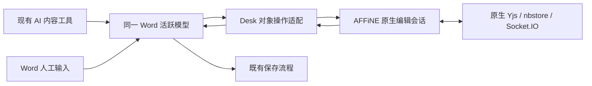

## Context

Desktop 是 Electron＋React，内置本地 TypeScript Server 管理文件、Office 原生模型、保存和 AI 工具。More 已承载工作台入口，账号系统已有租户切换。Office 页面仅连接本机引擎及既定资源，不能直接把它的网络地址改为 Docs WebSocket。AFFiNE 页面在独立 WebContentsView 中使用原生协作，Desk 适配对象操作。

## Goals / Non-Goals

目标为 More 内云文档、免重复登录、Personal／团队隔离、原生协作页面、本地 Word 和现有 AI 双向适配。云端同步、合并、历史、评论和恢复沿用 AFFiNE。本地 Office 编辑继续可独立使用。首版不支持 XLSX／PPTX 在线协同、Microsoft Word／WPS 实时桥接或新的离线补丁日志。

## Decisions

### 1. 模块与职责

| 模块 | 位置 | 职责 | 依赖 |
| --- | --- | --- | --- |
| CloudDocsPage／导航 | React shell、domains/cloud-docs | More、页面状态及租户路由 | DenAuth、宿主能力 |
| CloudDocsPanel | Electron 新模块 | WebContentsView、Cookie 分区、布局、下载及外链 | 现有宿主模式、Docs URL |
| DocsSessionLifecycle | Cloud Auth 衔接 | 启动交接，切换账号／组织及退出清理 | Server 契约；不复制认证实现 |
| CloudDocsBindings | 本地 Server 新模块 | 文件与页面持久关联、重新定位、断开 | 既有工作区文件身份与持久化模式 |
| DocsEditorHost | Electron／受限 preload | 原生编辑会话引用与消息桥 | Docs editor-bridge.md |
| WordAdapter | 本地 Server＋Office 页面桥 | 真实对象操作映射、远端回写与来源识别 | Office SDK、原生编辑桥 |
| Artifact Intake | 既有文件／产物操作扩展 | 保存准备、选择空间、预览、上传及结果定位 | prepareOfficeFile、Docs intake |
| DocsNotificationBubble | 既有 jugglechat 自定义消息与气泡 | 站内外消息入口、预览、租户及评论定位 | Server notification-delivery.md；不重建通知中心 |

云文档路由采用组织级 `/cloud-docs/:tenantId`；页面 ID 作为明确目标传入，不能以本地 workspaceId 代替源租户。当前组织从 DenAuth 获取，个人账户也有明确 tenantId。规范使用“本地工作区”“源租户”“Docs Workspace”三个名称，禁止混用。

同一 Server 支持多组织，但 Desktop 当前云文档仅取已登录并成功进入的组织。全局账号登录不自动聚合多个组织的目录、搜索、通知或附件；URL 和群卡片不能直接改变云视图所属组织。组织进入、同 IM App 隔离、卡片来源和切换异常的唯一交互契约为 [card-navigation.md](card-navigation.md)。

### 2. 产品形态

```text
[已有 Desktop 左侧主导航]  [当前 Personal／组织名称]
  ...                      [新增云文档内容区]
  More → 云文档              AFFiNE 原生空间／目录 | 原生编辑页
                              原生评论、历史、在线成员
```

保留现有主导航宽度与交互；云文档内部复用 AFFiNE React 页面，不在 Desktop 重新实现文档树和权限面板。React 使用现有组件库承载 DropdownMenu、Dialog、AlertDialog、Button、Toast 及状态外壳，文案接入中英文 i18n。

| 控件／入口 | 触发 | 反馈 | 失败与恢复 |
| --- | --- | --- | --- |
| More → 云文档 | 读取明确当前租户；可固定到左侧导航并本机持久化 | “正在打开云文档”，进入原生首页；云朵文档专用图标显示当前选中态 | 未启用／不可用显示原因和重试 |
| 组织内文档链接 | 解析规范租户与 pageId | 同租户直接定位；不同租户弹出切换确认 | 无成员或无空间权限拒绝，不把链接当授权 |
| Word 顶栏 → 上传到云文档并双向同步 | 后台上传到当前组织 Workspace，保留 Word 页面 | 关联及首个检查点完成后显示双向同步状态，显式打开云端 | 无写权限或上传／关联失败显示错误，不宣布同步成功 |
| Word → 关联云文档 | 新建或选择同租户可编辑页面 | 经 PoC 支持能力检查后显示关联状态 | 不支持或权限不足保留文件，不显示已同步 |
| Word → 打开云文档 | 打开关联的原生页面 | 不改变文件关联或创建副本 | 身份失效走原有登录 |
| Word → 断开关联 | 明确确认 | 停止适配，保留两端现有内容 | 未决写入先核对，不静默重放 |
| IM 云文档通知卡片 | 解析当前 IM 连接来源、租户和页面 | 同租户打开；跨租户确认切换，评论可定位 | 未知版本、已退出组织、无权限／删除均不盲开 |

Word 文件工具栏的保存和云端操作仅显示图标。保存状态保留真实生命周期，悬浮提示区分已保存、未保存、保存中及不可保存；无修改时不能触发保存，但仍能查看提示。云端按钮使用灰色云朵箭头，开启时显示上下双箭头、未开启／暂停时显示单个向上箭头；不使用蓝色区分状态，状态和打开／启用动作均由提示说明。独立窗口复用图标，仅读取当前已登记模型的真实关联；已关联时在主窗口授权打开原页面，未开启时返回所属工作区启用，不复制源登录或独立启动另一套上传／同步控制器。

More 首版保留一个云文档入口，不要求用户配置协作协议或新增登录方式。入口可按现有 More 应用规则固定或取消固定，固定状态仅保存在本机；图标使用圆角实心文档与右下云朵叠放的图形，文字和图层间隔透明镂空，默认弱化、选中强化，颜色跟随深浅主题。More 与固定导航复用同一图标，遮罩 ID 按组件实例区分，不使用 AFFiNE 品牌标识。Personal 页显示“我的文档”；团队页显示组织名称和“组织协作”。公开分享入口不出现。

云文档在 Desk 窗口顶部复用漫剧工厂的搜索与左侧栏控件样式；左侧栏展开时按钮随其实际宽度对齐，收起后仍保留展开和搜索入口。右侧栏按钮固定在窗口顶部右上角。AFFiNE 页面内不重复显示左侧独占按钮行或右侧展开／收起按钮。所有操作通过当前实例的固定展示命令调用 AFFiNE 原生侧栏和搜索，快捷键及拖动改宽后的真实状态回传 Desk；不维护第二份持久化侧栏状态，不重建编辑会话。Server Web 内嵌页面保留原浏览器控件。

窗口顶部空白区域支持按住拖动，搜索、收起和导航等按钮使用不可拖动区域，文档正文保持正常选择和编辑。由于原生云文档视图高于宿主网页浮层，云文档页面的左侧导航使用系统提示，避免悬浮文字被内容视图遮挡；其他页面沿用原有网页提示。

### 3. 页面装载和生命周期

Desktop 为本轮创建 UUID instanceId，使用现有 JuggleWork Session 向 Server 提交 target 与 presentation={instanceId,mode} 申请一次性交接，主进程仅 POST grant 装载 Docs bootstrapUrl。展示模式和实例随凭据绑定，Docs 依据 consume 结果进入 product／manage／editor 并在初始化后发送匹配的 ready。源长期令牌只留在现有身份机制中；原生页面 origin 和租户键以 Server 返回值为准。同账号的前台产品页和后台 Word 页各有实例，不能共用一个全局实例值。

会话分区至少按 sourceServerOrigin＋sourceUserId 隔离，租户 origin 使用独立子域。账号切换、Server 来源变化、注销时先关闭相关云视图及桥，再发布新的身份；源租户切换只关闭旧租户可写视图和适配，不销毁其他本地文件。

| 状态 | 可见表现 | 退出条件 |
| --- | --- | --- |
| loading | 正在打开云文档 | 收到当前实例 ready 或失败 |
| ready | 原生产品页 | 导航、身份切换或真实连接错误 |
| unavailable | 云文档暂时无法连接；重试 | 新交接成功；15 秒未就绪也进入此状态 |
| unauthorized | 登录已失效 | 现有 JuggleWork 登录成功后重新打开 |
| forbidden | 你没有此空间的访问权限 | 当前权限重新验证成功或离开页面 |

组织切换前检查原生 pendingLocalChanges 与 Office 保存状态：可取消切换；确认后停止旧连接，保留允许恢复的原生本地数据。下一次访问仍需授权，不允许依靠缓存绕过已退出组织。旧 instanceId 的异步结果不能激活新租户页面。

WebContentsView 复用现有隐藏／布局／覆盖层模式。宿主菜单、对话框和 Toast 不能被原生视图盖住；切换页面时隐藏而非无条件重建原生编辑会话。远程页面 nodeIntegration=false、contextIsolation=true、sandbox=true，只暴露编辑桥所需操作；文件读取、保存和 SDK 调用仍由本地 Server／Electron 执行。

### 4. 原生会话存活与双向适配

产品页和后台编辑页的原生 WebContents 均关闭后台动画及计时器限速，隐藏授权与跨空间导航期间仍完成初始化；可见性仍由当前实例的授权就绪状态和宿主覆盖层控制。

产品视图从隐藏恢复为可见时恢复 WebContents 焦点，使原生引擎接收 focus 并正常恢复编辑输入；已可见页面的周期授权检查不重复抢焦点。

一个打开且已关联的 Word 保持一个原生 Docs 编辑会话／写入桥，生命周期由主进程管理；关闭 Word 或断开关联释放引用。普通云文档页面可以作为另一原生客户端独立浏览，但不重复建立同一绑定的 Word 回写桥。前台切换页面不得把后台 Word 的协作会话导航到另一个文档。

原生 provider 负责 WebSocket、Y.Doc、IndexedDB 与重连。Office SDK 保持原本地模式；Desk 将其变化通过受限桥送入原生 BlockSuite 事务。远端原生变化再通过受限桥回到同一 Office 模型。具体能力、对象与故障矩阵由 [word-adapter.md](word-adapter.md)唯一维护。

即时输入不等待网络；原生 nbstore 按文档调度和合并 Yjs 更新，桥与 SDK 不再增加输入等待。输入、远端可见及保存分别按 [协作性能契约](../../../../jugglework-docs/openspec/changes/add-jugglework-docs-adaptation/collaboration-performance.md)验收；正常关闭与失权停止需保留不同顺序。



本地人工输入和 AI 修改都必须被捕获；只拦截 AI MCP 调用不符合要求。回写不是新用户／助手轮次，不得伪造消息。来源标记只防同一已应用操作回环，不生成第二套云端版本或补丁队列。

### 5. 本地文件关联

关联记录由本地 Server 单写，使用既有 JSON 持久化模式，文件名 `cloud-doc-bindings.json`；不新增本地数据库和锁服务。

| 字段 | 类型／约束 | 含义 |
| --- | --- | --- |
| schemaVersion | integer=2 | 本地元数据格式版本，非协作协议；旧版无检查点保持暂停 |
| attachmentId | UUID | 稳定关联 ID；当前主进程与后台编辑器使用同一身份 |
| sourceServerOrigin / sourceUserId | string，必填 | 账号来源与主体 |
| tenantId / docsWorkspaceId / pageId | string，必填 | 明确云端归属；Workspace 为原生 ID，pageId 为 1～64 位字母／数字／下划线／连字符 |
| localWorkspaceId / relativePath | string，必填 | 本地工作区与其相对路径；路径只保留本机 |
| registeredLocalFileId | string，可空 | 复用已登记本地文件身份，存在时优先解析 |
| state | string | linked/paused/unlinked |
| mappingVersion | integer | 已验证的 Word 映射版本 |
| checkpoint | object，可空 | 共同检查点；字段和恢复流程唯一维护于 word-recovery.md |
| updatedAt | UTC ISO 字符串 | 最近一次关联状态变更时间 |

一份本地文件只允许一条生效云关联，同一账号／租户／云页面在当前本地工作区只保留一个活跃 Word 写入绑定。跨设备可各有一个原生客户端。导出副本默认不建立关联；跨租户发布需另存副本或明确断开旧绑定后重新关联，不能因切换当前组织自动重绑。

路径变动通过现有文件操作更新；外部重命名导致无法解析时提示“关联文件已移动，请重新定位”，不按同名猜测。当前 engineFileId、model ID 和 WebContents ID 不作为持久关联身份。关闭重开恢复关联前重新授权和验证模型代次。

首次关联和重开还必须执行 [word-recovery.md](word-recovery.md) 的文件身份、原生检查点、实际对象及映射验证。DOCX 字节变化但已支持对象与共同版本一致时仍可恢复云端变化；实际本地内容独立变化、检查点缺失或映射不能恢复时暂停并保留双方，不能按 pageId 直接宣布同步成功。检查点不成为第二套云端版本。

### 6. 文件上传与首次转换

Word 顶栏“上传到云文档并双向同步”先完成现有 Office 保存，再从存活 SDK 读取基础对象。文件预检和下载复用当前 Word 所属的工作区客户端及其凭据，不能用组织控制面地址读取本地文件。下载同一真实 DOCX并计算 SHA-256，下载摘要必须与本次 Office 保存结果一致。当前组织 product 页在后台保持隐藏，以同一 requestId 完成 multipart preview、原件 Blob 保存、commit 和未知结果 status 核对，再申请独立 editor 交接并逐项核对映射；成功或失败都释放临时 product 页，Word 编辑器保持原位置，不自动跳转。请求复用限定来源服务器、账号、租户、文件路径及保存摘要。主进程以 `attachmentId` 管理一个 Word 页面桥、一个后台 AFFiNE 页面和一个双向控制器；保存前 flush，paused／unknown 阻止保存。

上传期间禁用重复提交；只有关联及首个共同检查点完成才显示“双向同步中”，暂停或断开显示“同步已暂停”。已关联文件不显示重复上传入口。主窗口提供显式“打开云端”按钮，独立文件窗口显示同步状态。验证双向同步使用唯一测试文本：本地 Word 输入后手动保存，打开云端确认正文；云端修改同一基础文本，返回本地确认回写，再保存并重开 Word 确认落盘。原件附件只是上传时的快照，不作为后续同步结果。该验收不代表复杂表格、图片和其他未支持对象已覆盖。

该路径已在逐对象核对后原子写入 `cloud-doc-bindings.json` schemaVersion=2，保存账号、租户、页面、本地文件定位和 paragraphId→blockId，不保存正文、grant 或 token。同一文件／attachment 只保留一条记录；退出或不可恢复错误转 paused，显式解除／替换转 unlinked。启动时没有共同检查点的旧 active 记录转 paused，不猜测恢复。Word 创建请求使用稳定 requestId，Docs 持久记录请求摘要和确定 pageId；响应丢失后重试返回同一页面，改变同一 requestId 的正文则拒绝。

Office Server 在真实 DOCX 落盘后流式计算 SHA-256；Desk 只在 Word revision、AFFiNE Y.Doc 状态向量和对象映射于保存前后均未变化时，写入不可变原生快照／映射资源并原子推进共同检查点。资源只保留当前和上一份，检查点失败不回滚已成功的本地 Office 保存。

首次关联会立即保存真实 DOCX 并要求首个检查点成功，失败则解除活动会话。重启后所有旧 active 先转 paused；打开同一路径 Word 时，Desk 使用当前账号和组织申请新 editor 交接，核对本地摘要、原生 Workspace、快照状态向量和 Yjs 字符映射。基础文本的云端单独变化定点回写新 Word 模型并保存新检查点；本地摘要变化、资源缺失、映射或新检查点不确认时保持 paused。

该路径已把原始 DOCX 保存到当前组织 AFFiNE 原生 Blob，实现 page 模式 preview／commit／status，并在页面正文中幂等创建原生附件块。产品目标固定当前组织 Workspace，不提供目标空间／目录选择或独立 attachment-only 模式；文件移动显式重定位已有源码，真实 Electron＋远端 Provider 的跨重启联合矩阵仍未验收。

调用 prepareOfficeFile／现有文本保存流程后读取真实文件。运行中、选区 needs-verification、保存失败或原生模型未知时阻止上传并保留原工作流。目标固定当前源租户，空间清单来自 Docs 的原生有效空间权限。

| 文件 | 提交方式 | 成功终态 |
| --- | --- | --- |
| Markdown／HTML | 社区正文导入 | 可编辑 Docs 页面 |
| DOCX | 10MiB 内，明确点击即确认 page 模式；保存原件、预览并创建原生页面 | 当前基础对象首次转换成功；仅在逐对象核对和首个检查点通过后建立双向绑定 |
| XLSX／CSV／PPTX／PDF | 50MiB 内，资料页附件 | 附件可访问，不显示在线 Office 协同 |

请求固定 UUID requestId，未知结果显示“上传结果待确认”，查询同一原生任务后再决定重试。不能把“已发送请求”显示为创建成功；失败保留本地原件。图片与附件由 Docs 上传到目标页面，不能携带原租户私有 URL 直接给新组织成员。

### 7. Word、AI、选区与保存

远端写入当前 SDK 前必须使用现有 OfficeDocuments 解析准确 documentId、engineFileId 和模型代次。AI 正在执行、输入法组合、页面提交未结束、选区未知写入期间，遵守已有 admission／保存限制；不能从云桥绕过。

云端仍继续原生协作。本地无法安全立即回写时仅标记当前原生会话的待适配状态，等待既有安全边界；对象定位或待处理能力不足则暂停，不能另建无限补丁队列。模型变化导致的选区引用失效按现有 stale／needs-verification 处理，不静默刷新已排队引用。

远端修改必须回写活跃模型后再经原保存落盘；不能仅替换磁盘 DOCX，让旧活跃模型下一次保存覆盖云端结果。sourceRemote 标记避免 SDK 发出的回写事件再次成为新本地修改。

Viewer 可阅读和下载副本，但不能建立双向可写绑定。已有绑定降为 Viewer 时暂停适配并显示“需要编辑权限才能同步”，用户可继续使用独立本地文件；不能自动回写覆盖可能产生的本地修改。

### 8. 站内与 IM 通知

首版同步交付 AFFiNE 站内通知和 JuggleIM 通知。站内继续使用原生通知列表／未读，不复制到另一个自建收件箱。IM 注册 jw:docs-notification 消息，在现有 jugglechat 的注册表、气泡、会话预览、未知类型兜底及原生通知策略中接入。群与定向的受众、payload 和持久投递以 [notification-delivery.md](../../../../jugglework-server/openspec/changes/add-jugglework-docs-integration/notification-delivery.md)为准。

全组织可见文档可发组织受管群，限定成员文档只定向给原生有权收件人。卡片不带标题／正文／评论原文或凭据；点击不调用 AI，使用当前 IM 连接对应 Server 的真实用户会话重新申请 product/page 交接。跨组织确认切换，尚未登录正确账号则先走既有登录，不采纳消息内任意来源 URL。commentId 只用于原生已授权评论定位。

站内和 IM 未读独立，点击 IM 不批量清空站内未读；同一 IM 来源＋tenantId＋eventId 去重展示。Personal 不连接 IM。切账号、组织或更换 Server 后，旧消息不能沿用旧云页面实例执行导航。

卡片使用固定模板和结构化打开动作，不接受任意 URL／HTML。同 App 多组织必须在进入会话、预览、未读和系统提示前过滤云文档群／助手历史；消息回调捕获接收时来源及凭据代次，不以点击时的全局 IM 连接猜来源。跨组织历史系统通知经确认、真实 switchOrganization 成功后再打开；IM 失败不回滚已完成的组织切换。具体行为及验收见 card-navigation.md。

### 9. 状态与真实反馈

| 状态 | 文案／行为 |
| --- | --- |
| 未关联 | 可上传或关联，不显示同步成功 |
| 正在连接 | 等待原生身份、页面、schema 和 SDK 映射准备 |
| 已连接 | 表示协作会话有效；本地“已保存”单独取 Office 保存回执 |
| 离线 | 显示原生 provider 断线；已有原生会话继续使用其恢复机制，不另设离线队列 |
| 同步暂停 | 显示不支持对象、权限变化或模型状态原因；提供打开云文档、查看原因、断开关联 |
| 结果待确认 | 写入回执或本地保存结果未知；停止自动重试，保留双方内容 |
| 权限失效 | 停止原生写入、桥及重连回放，重新进入必须认证 |

provider synced 只表示原生同步状态；editor.applied 不等于 Word 已落盘；不据此显示“服务端已备份”。真实持久化通过其他客户端、刷新和服务重启验收，状态文案沿用上游已能证明的信号。

## Risks / Trade-offs

- SDK 能力尚未验证：Word 双向是首版必须通过的独立门槛，失败不降级为文件导入／导出后宣布全部完成。
- 原生视图后台存活增加资源：只为实际打开的绑定 Word 保活，关闭即释放；验证最小化、系统休眠与恢复，不承诺电脑关闭时更新本地文件。
- 同一页面多客户端：保留正常原生协作，确保只有一个本地写入桥，不重复套用远端操作。
- 本地已下载内容不能通过云端撤销追回：撤销阻止新访问和回放，不删除用户磁盘文件。

## Migration Plan

先发布宿主能力检查和默认关闭的入口，再接入身份／页面。Word PoC 通过后单独启用已验证类别；其他文件功能保持。回滚关闭桥和新入口、释放会话、保留文件与关联元数据。不得为了恢复云功能改变现有 Office 网络策略或替换仍活跃模型。

## Validation gates

先在当前 macOS ARM64 验证真实 SDK，再验收 macOS Intel、Windows 和签名安装包。必须完成 Person／A／B、跨账号、单设备退出、菜单覆盖、中文 IME、保存、选区 AI、两设备原生协作和文件重开。文档校验和工具目录存在均不是这些能力的运行证明。
