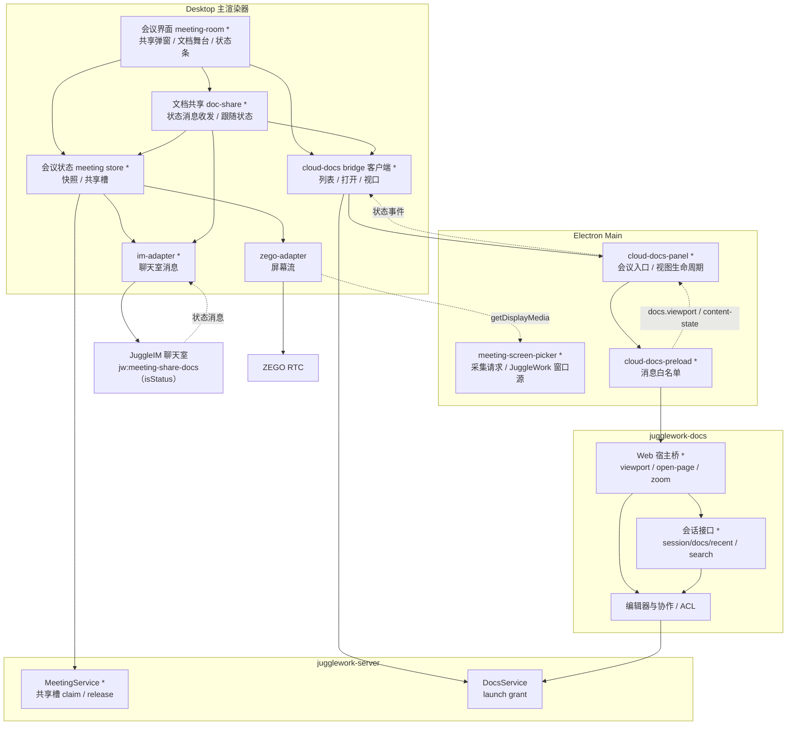
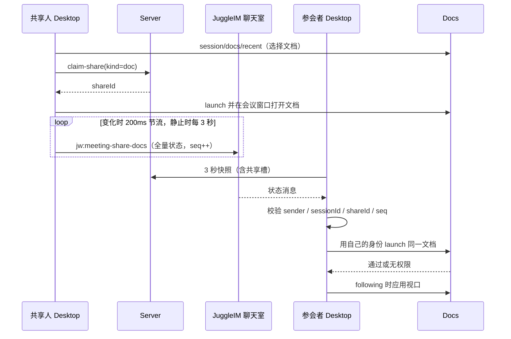

# 会议共享 JuggleWork 与云文档妙享设计

## 1. 参考行为

飞书会议的共享，来源为飞书帮助中心[使用共享屏幕功能](https://www.feishu.cn/hc/zh-CN/articles/360046586533)和[使用妙享功能](https://www.feishu.cn/hc/zh-CN/articles/360047005834)：

- 共享桌面与窗口：传视频画面，可选桌面或单个窗口。
- 投文档（妙享）：参会人默认跟随共享人，双击或滚动进入自由浏览，点击「跟随共享人」回到共享人位置。缩放只作用于本地。参会人可「成为共享人」，跟随中的人跟到新共享人，自由浏览的人保持原状态。共享人点击文档内链接时，跟随者一同进入新文档。

本方案采用跟随、自由浏览、本地缩放、成为共享人和链接跟随。共享电脑音频、暂停共享、远程控制、标注、临时授权、上传本地文件不在范围内。

## 2. 现状

| 位置 | 事实 |
| --- | --- |
| `apps/desktop/electron/meeting-screen-picker.mjs` | 会议窗口调用 `getDisplayMedia` 后，Main 生成一次性 requestId，通知主渲染器打开选择弹窗。`getSources({types:["screen","window"]})` 枚举源，确认时校验源仍在本次枚举中。请求 120 秒超时，取消时回调 null |
| `apps/app/src/react-app/domains/meeting/meeting-screen-picker.tsx` | 弹窗标题「桌面与窗口」，按 requestId 挂载。分类、应用图标筛选、缩略图网格、底部「取消 / 开始共享」 |
| `apps/app/src/react-app/domains/meeting/zego-adapter.ts` | `startShare` 采集后经 `createStream({custom})` 发布。`AbortError`（用户取消）不发布、不报错 |
| `apps/app/src/react-app/domains/meeting/meeting-room.tsx` | 会议窗口是主渲染器 `window.open("about:blank","jugglework-meeting")` 打开的空白页，复制主窗口样式后由 React Portal 绘制，没有 preload |
| `apps/app/src/react-app/domains/meeting/store.ts` | 入会后每 3 秒拉一次会议快照并发送 `jw:meeting-sync`。聊天室收到 `jw:meeting-sync` 时也会触发快照刷新 |
| `apps/desktop/electron/cloud-docs-panel.mjs` | `getWindows` 只含主窗口和文件窗口，`ownerFor` 要求 IPC sender 就是所属窗口自身的 webContents。原生视图在所属窗口 `contentView` 的最上层 |
| `apps/app/src/react-app/domains/cloud-docs/use-cloud-docs-bounds.ts`、`cloud-docs-visibility.ts` | 只在主窗口 `document` 中测量 bounds、检测弹窗和菜单。被遮挡时先截图垫底，再隐藏原生视图 |
| `apps/desktop/electron/cloud-docs-panel.mjs` `jugglework:docs:api` | 宿主经产品页调用 Docs，op 白名单为 search、read、edit、create |
| Docs `core/jugglework-ai.ts` `search` | 会话侧 `ai/search` 只按标题检索可读文档，返回 `workspaceId、docId、title、scope、updatedAt`，不返回内容类型 |
| Docs `core/jugglework-app.ts` | App 外壳接口 `docs/recent`、`docs/search` 返回 `contentKind`（document / whiteboard / spreadsheet / presentation），但要求 App 会话，不能从 Desktop 产品页调用 |
| Docs `apps/web/src/jugglework-host.tsx` | 页面内部导航保持，切换同一 workspace 内的文档不需要重新 bootstrap |
| Server `services/meetings.go` | `Meeting` 以 JSON body 持久化，没有共享字段。`save` 每次 `Version++`。参会者 `LastSeenAt` 超过 90 秒视为离线 |
| `apps/app/src/react-app/domains/jugglechat/runtime.ts` | `jw:meeting-sync` 注册为 `isCount:false,isStorage:false`，`snl:typing` 注册为 `isStatus:true` |
| JuggleIM SDK、`im-server` | `isStatus` 为 flag bit2。状态消息不写会话、收件箱、发件箱，只直投在线连接，跳过拦截器。命令消息（bit0）写入 cmd inbox 并离线补发。本地 `im-server` 检出（`2b6777c`）没有聊天室分发代码 |
| Electron | `BrowserWindow.getMediaSourceId()` 可用。`webContents.setZoomFactor` 在同一 session 内按 host 共享缩放 |

## 3. 两条路线

| 维度 | A. 共享 JuggleWork 窗口（视频画面） | B. 文档妙享（状态同步） |
| --- | --- | --- |
| 观看者看到什么 | 共享人主窗口画面，包括侧栏、聊天和通知 | 用自己的账号打开同一文档，只看到有权看的内容 |
| 自由浏览、编辑 | 不支持 | 支持，编辑走现有 Docs 协作 |
| 无文档权限的成员 | 能看到画面 | 看不到，显示无权限 |
| 改动面 | Desktop | Desktop、Server、Docs |

### 3.1 模块依赖

实线为调用方向，虚线为事件或消息回传。依赖只从上层指向下层，没有环。标 `*` 的模块为新增或需要修改。



| 模块 | 职责 | 不负责 |
| --- | --- | --- |
| 会议界面 | 共享弹窗、文档舞台、视频栏、状态条、异常状态 | 业务判断 |
| 会议状态 | 3 秒快照、共享槽 claim / release、屏幕共享推流 | 文档位置 |
| 文档共享 | 共享人发布状态；参会者校验、跟随 / 自由浏览、10 秒中断判断 | 打开文档的授权 |
| cloud-docs bridge 客户端 | 申请 launch grant、调用 Main 打开会议视图、列表 api、视口命令 | 正文读写 |
| meeting-screen-picker | 一次一个采集请求、源校验、JuggleWork 主窗口源 | 弹窗界面 |
| cloud-docs-panel | 在会议窗口创建、定位、保存后销毁 Docs 视图；只接受主窗口控制 | 会议状态 |
| cloud-docs-preload | 页面与宿主之间的字段白名单 | 业务逻辑 |
| MeetingService | 唯一共享槽，离会 / 移除 / 结束 / 90 秒失联时清空 | 文档与视口 |
| Docs 宿主桥 | 视口上报与应用、页内跳转、本地缩放、共享人相对位置 | 会议身份 |
| Docs 会话接口 | 按会议组织列出和检索可读文档，返回内容类型 | 写入 |
| JuggleIM 聊天室 | 在线投递状态消息 | 存储、授权 |

### 3.2 发起文档共享的时序



## 4. 界面

设计稿：`mockups/` 下三张由图像模型生成的参考图，用于确定布局和信息层级。文字、图标和细节以本节为准。

### 4.1 共享弹窗

参考 `mockups/meeting-share-picker-docs.jpg`。

- 工具栏「共享」打开现有弹窗，标题改为「共享」，顶部是分段切换「桌面与窗口 | 云文档」，沿用会议 `.segmented` 样式。
- 「桌面与窗口」页保持现有内容，网格首位固定「JuggleWork」主窗口项（路线 A）。
- 「云文档」页：
  - 顶部搜索框，占位「搜索当前组织的云文档」，输入 300ms 去抖。
  - 搜索框为空时显示最近访问列表，有输入时显示标题检索结果，各取 20 条。
  - 每行：类型图标、标题、`更新时间 · 组织 / 私有`。
  - 文档、白板、思维导图、表格、幻灯片均可选。
  - 底部左侧「已选择：标题」，右侧「取消」「开始共享」。按钮上方一行提示「参会者将用自己的权限打开该文档，可跟随你浏览，也可自由浏览」。
  - 当前组织未开通云文档时，该页显示不可用说明，不显示列表。
- 与设计稿的差异：不做「我创建的 / 与我共享」筛选，不显示所有者。Docs 现有列表数据没有所有者字段，筛选也没有对应接口。

### 4.2 参会者：跟随中

参考 `mockups/meeting-docs-share-following.jpg`。

- 会议主区域左侧是文档舞台，右侧是竖向视频栏。视频栏宽 220px，超过 4 人时滚动。成员或聊天侧栏打开时隐藏视频栏。会议窗口宽度小于 960px 时视频栏收起为舞台下方一行头像。
- 文档舞台上方是共享状态条：共享人头像与「林知远 正在共享」、绿色「跟随中」、缩放「− 100% +」、「成为共享人」。
- 与设计稿的差异：原生文档视图盖在会议窗口所有 DOM 之上，状态条不能悬浮在文档上，改为舞台上方独立一行。
- 文档内共享人位置标记：只在自由浏览时显示，跟随时本地视口就是共享人位置，不显示。标记由 Docs 页面绘制，固定定位、不接收指针事件、不写入文档内容。
  - 页面模式：共享人所在块在可视区内时，在该块位置画一条细线和「名字 在这里」；在上方或下方时，贴着视口顶部或底部显示「↑ 名字 在上方」「↓ 名字 在下方」。
  - 白板模式：共享人视口中心在可视区内时显示标记；在区域外时，贴着最近的边显示指向箭头。
  - 共享人切换到本地没有打开的文档时清除标记，状态条显示「共享人已切换文档」。

### 4.3 参会者：自由浏览

参考 `mockups/meeting-docs-share-free-browsing.jpg`。

- 状态条显示灰色「自由浏览中」，以及蓝色主按钮「跟随共享人」。
- 状态条右侧显示共享人位置，例如「共享人在「二、首页改版方案」↑」，点击等同于「跟随共享人」。章节名由参会者自己的页面从本地文档中读取，消息中不传标题。
- 与设计稿的差异：位置提示放在状态条内，不悬浮在文档右下角，原因同 4.2。参会者工具栏的「共享」按钮保持普通状态。

### 4.4 共享人

- 共享人的文档也在会议窗口舞台中打开，布局与参会者相同。
- 状态条为「你正在共享」、缩放、「更换文档」、「停止共享」。
- 工具栏「共享」在共享期间变为「停止共享」，与屏幕共享一致。
- 他人成为共享人时，原共享人收到提示「林知远 已成为共享人」，自己转为跟随中。

### 4.5 异常状态

| 状态 | 舞台显示 |
| --- | --- |
| 正在打开 | 舞台骨架和「正在打开文档…」 |
| 无权限 | 「你没有该文档的访问权限」，副文案「可请共享人改用 JuggleWork 窗口共享」 |
| 格式不支持 | 「该文档类型暂不支持跟随浏览」 |
| 位置同步中断 | 文档保留，状态条显示「位置同步已中断」，恢复后自动消失 |
| 共享结束 | 舞台关闭，回到视频宫格，提示「共享已结束」 |

## 5. 路线 A：共享 JuggleWork 窗口

- 「桌面与窗口」网格首位固定「JuggleWork」项，源 ID 取自 `mainWindow.getMediaSourceId()`。确认时仍要求该 ID 出现在本次 `getSources` 结果中，否则提示改选其他窗口。
- 采集范围只有主窗口。会议窗口和紧凑控制窗口不进入画面。
- 主窗口顶部显示「正在共享此窗口」条和停止按钮。
- 推流、停止、离会清理沿用 `startShare` 和 `stopShare`。

## 6. 路线 B：文档妙享

### 6.1 职责划分

| 内容 | 权威来源 | 通道 |
| --- | --- | --- |
| 谁是共享人（共享槽） | Server 会议聚合 | 业务 API 与 3 秒会议快照 |
| 共享人当前在看哪篇文档、看到哪里 | 共享人客户端 | 状态消息 `jw:meeting-share-docs` |
| 文档访问权与正文 | Docs | 每个参会者自己的 launch 与协作连接 |
| 跟随还是自由浏览、缩放 | 每个参会者本地 | 不传输 |

### 6.2 共享弹窗与采集请求

`getDisplayMedia` 必须在用户手势中调用，Main 的选择请求有 120 秒超时，因此两个页签分别处理：

- 点击「共享」：渲染器打开弹窗，默认停在上次使用的页签。停在「桌面与窗口」时，立即在同一手势中调用 `startShare`，弹窗绑定 Main 下发的 requestId。
- 切到「云文档」：取消当前采集请求，`startShare` 按 `AbortError` 静默结束。
- 切回「桌面与窗口」：页签点击作为新手势，重新调用 `startShare` 获取新 requestId。
- 采集请求超时只清空「桌面与窗口」页并显示「点击刷新」，不关闭弹窗。
- Main 每次只保留一个采集请求（`pending`），新请求必须等上一个请求的取消回调完成后再发起。页签连续切换时以最后一次点击为准。
- 弹窗从「Main 事件挂载」改为「渲染器状态挂载」，`meeting-screen-picker.mjs` 的请求校验不变。

文档列表经现有 `jugglework:docs:api` 通道获取：

- Desktop op 白名单增加 `recent`。
- Docs 新增会话侧 `session/docs/recent` 与 `session/docs/search`，复用 `JuggleworkApp.recent / search` 的目录、ACL 与 `contentKind` 逻辑。

### 6.3 Server 共享槽

`Meeting` 新增 `Share *MeetingShare`，随快照公开：

```go
/**
 * 会议当前共享槽
 * @param ID        共享 id，每次占用重新生成
 * @param Kind      共享类型：screen / doc
 * @param UserID    共享人
 * @param SessionID 共享人的参会会话
 * @param StartedAt 占用时间
 */
```

- `claim-share`：在会参会者以当前 `SessionID` 占用，直接替换已有共享，返回新 `ID`。
- `release-share`：携带 `shareId`，只有共享人本人或主持人可释放。`shareId` 不是当前值时不改变共享槽，返回当前快照。
- 两个 action 不要求 `Version`，避免与编辑、锁定等操作互相 409。
- 共享人离会、被移除或会议结束时清除 `Share`。共享人 `LastSeenAt` 超过 90 秒时，快照投影返回空共享槽，不额外写库。
- 文档标识和位置不写 Server，共享人切换文档不产生 Server 写入。
- 屏幕共享同样先 claim 再推流，两种共享互斥。共享槽变化由 3 秒快照传播，不另发通知消息。

### 6.4 状态消息 `jw:meeting-share-docs`

#### 语义

状态消息描述“共享人此刻的样子”，命令消息要求“接收方去做某件事”：

| | 命令消息 | 状态消息 |
| --- | --- | --- |
| 内容 | 动作与参数，如“打开文档 X”“滚到 Y” | 发送方当前完整状态 |
| 送达 | 要求可靠，离线补发，需要幂等键与确认 | 只投在线，允许丢失，不确认 |
| 多条之间 | 每条都要执行，顺序和次数影响结果 | 后一条覆盖前一条，只有最新一条有意义 |
| 接收方 | 照做 | 自行决定如何把本地视图收敛到该状态 |
| JuggleIM 标记 | `isCommand`（cmd inbox） | `isStatus`（不存储、不计数、不进会话） |

`jw:meeting-share-docs` 是状态消息，遵守以下约束：

1. 全量：每条携带共享人当前的完整文档与视口状态，不发增量，不含“打开”“滚动”“跟随”“请重发”等动作字段。
2. 最新者胜：同一 `shareId` 内按 `seq` 递增，接收方丢弃不大于已应用值的消息，不补历史。
3. 幂等：重复应用同一状态没有副作用。
4. 可丢：状态变化时节流发送，静止时定时重发。接收方不请求重发，新入会者等待下一条。
5. 接收方决定：消息不指定接收方行为。跟随中的人应用视口，自由浏览的人只更新位置提示。
6. 不承载授权：共享人身份以 Server 快照为准。消息只是共享人自报，接收方校验发送者。
7. 有寿命：超过有效期未收到新状态即视为过期。共享结束也以一条状态表示。

#### 注册与载荷

```ts
{ name: "jw:meeting-share-docs", isStatus: true }
```

```json
{
  "schemaVersion": 1,
  "meetingId": "mtg_...",
  "shareId": "shr_...",
  "sessionId": "ses_...",
  "seq": 42,
  "state": "sharing",
  "doc": { "workspaceId": "...", "pageId": "...", "mode": "page" },
  "viewport": { "anchor": { "blockId": "...", "offset": 0.35 } }
}
```

| 字段 | 说明 |
| --- | --- |
| `schemaVersion` | 固定 1，未知版本忽略 |
| `meetingId`、`shareId`、`sessionId` | 与快照中的会议、共享槽和共享人会话对应 |
| `seq` | 同一 `shareId` 内单调递增的整数，只用于排序，不使用发送时间 |
| `state` | `sharing` 或 `ended`。`ended` 时省略 `doc` 与 `viewport` |
| `doc.workspaceId`、`doc.pageId` | 共享人当前路由中的 Docs 不透明 ID，`[A-Za-z0-9_-]{1,64}` |
| `doc.mode` | `page` 或 `edgeless` |
| `viewport.anchor` | 页面模式：视口顶部所在的最内层正文块的 `blockId`，以及视口顶部相对该块的偏移 `offset`（按块高归一化，-20–1；视口顶部在首个正文块之上即标题区时为负） |
| `viewport.edgeless` | 白板模式：`{centerX,centerY,zoom}` 画布坐标 |

- 单条不超过 1 KB，不含正文、标题、URL、选区文字或用户输入。
- 页面模式用块锚点而不用 `scrollTop`，因为各人窗口宽度和缩放不同，排版高度不同。

#### 发送

- 共享人在 `doc` 或 `viewport` 变化时以 200ms 节流发送，节流窗口结束时保证发出最后一个状态。
- 静止时每 3 秒重发一次当前状态，`seq` 照常递增。
- 停止共享时发一条 `state:"ended"`，随后调用 `release-share`。接收方不依赖这一条。
- 共享人在文档内点击链接后，页面路由变化，下一条状态自然带上新文档，实现链接跟随。

#### 接收

- 只接受 `sender.id`、`sessionId`、`shareId` 与快照中共享槽一致的消息。`shareId` 未知时触发一次去抖的快照刷新，刷新后仍不一致则丢弃。
- 10 秒未收到新状态：保留当前文档，状态条显示「位置同步已中断」，收到新状态后恢复。
- 快照中共享槽清空、换人或收到 `ended`：结束本次跟随，按 6.5 关闭文档视图。

不选 Docs awareness：它广播给所有打开该文档的人，没有会议身份，无权限成员也收不到。不选 ZEGO 房间消息：现有架构约定业务状态不放在 ZEGO 房间内。

### 6.5 会议窗口中的文档视图

- Main 创建 Docs `WebContentsView` 并加到会议窗口 `contentView`，使用会议组织对应的 partition，以 `product` 模式 launch，target 为状态中的 `workspaceId / pageId`。
- `cloud-docs-panel` 增加会议入口：所属窗口固定为当前 `meetingWindow`，控制方是主窗口顶层 frame。open、bounds、close 只接受主窗口发送，并核对实例归属于会议入口。
- 切换文档：同一 workspace 内由宿主向页面发送导航命令，在页面内跳转。跨 workspace（私有文档）重新 launch。Docs 路由仍执行页面 ACL，无权限时页面上报错误。
- `useCloudDocsBounds` 与遮挡检测改为接受目标 `document`，在会议窗口文档中测量舞台。会议窗口内的设置、邀请、离会确认、共享弹窗按现有方式截图垫底并让出原生层。
- 该视图不参与刷新接管和启动预热。离会、共享结束或切换 workspace 时先走保存屏障再销毁。保存未完成时保留视图，状态条显示「正在保存」。
- 会议窗口隐藏或切到紧凑窗时，视图随窗口隐藏，状态消息照常接收。

### 6.6 Docs 宿主桥

`docs.ready` 的 `capabilities` 增加 `meetingViewport: 1`，宿主只对声明该能力的页面启用。

| 方向 | 消息 | 内容 |
| --- | --- | --- |
| 页面 → 宿主 | `docs.viewport` | `workspaceId`、`docId`、`mode`、`anchor` 或 `edgeless`、`userInput` |
| 宿主 → 页面 | `apply-viewport`（经 `meeting-command`） | `viewport`（`workspaceId`、`docId`、`mode`、`anchor` 或 `edgeless`）、`follow` |
| 页面 → 宿主 | `docs.sharer-relation` | `direction`（above / below / visible / missing）、`heading`（本地最近的上级标题，最多 80 字） |
| 宿主 → 页面 | `open-page`（经 `meeting-command`） | 同 workspace 内的 `docId` |
| 宿主 → 页面 | `zoom`（经 `meeting-command`） | 0.5–3 的本地缩放 |

- `userInput` 由真实输入事件判定（滚轮、键盘、指针拖动、双击、编辑），不由 scroll 事件判定，避免应用远端视口产生的滚动被误认为用户操作。
- `follow:true` 时页面即时滚动到锚点，不使用平滑动画。`follow:false` 时只计算相对位置。两种情况都回报 `docs.sharer-relation`。
- 缩放由页面缩放编辑器区域。不用 `webContents.setZoomFactor`，因为它在同一 session 内按 host 共享，会同时缩放主窗口的云文档。
- preload 按现有方式做字段白名单和长度校验。

### 6.7 跟随与自由浏览

参会者本地状态只有 `following` 和 `free`：

- 共享开始或入会时为 `following`，应用最新收到的状态。
- 收到 `userInput:true` 的视口上报后切到 `free`。
- 点击「跟随共享人」或位置提示，回到 `following`，立即应用最新状态。
- 最新状态的 `doc` 与本地文档不同：`following` 的人打开新文档，`free` 的人留在原文档，位置提示显示「共享人已切换文档」。
- 共享换人：`following` 的人跟随新共享人，`free` 的人不变。
- 成为共享人：参会者 claim 成功后，以自己当前的文档与视口发布第一条状态，原共享人转为 `following`。
- 幻灯片：状态带 `slides.slideId`，接收方切到同一页；放映中通过放映组件的跳转回调切页。自由浏览时，状态条提示共享人在本页之前或之后。
- 表格：状态带 `sheet.{sheetId,row,column}`（当前工作表与视口左上角单元格），接收方切换工作表并滚到该单元格。自由浏览时，状态条提示共享人在其他工作表。
- 页面位置由各编辑器通过适配器注册（Docs `jugglework-meeting-adapter`），会议视口桥统一上报与应用。
- 云文档列表：入会即启动并占住后台产品页，会议期间不被空闲回收；选择器按查询词在会议内缓存列表，先显示缓存再后台刷新，离会清空。
- 缩放不改变状态。

## 7. 待验证

- 主窗口采集是否包含 `WebContentsView` 内容；`getMediaSourceId()` 是否出现在 `getSources` 结果中（macOS、Windows 打包版）。
- 部署版 JuggleIM 聊天室是否按状态标记只投在线、不存储，以及每秒 5 条的限流与乱序表现。
- 会议窗口承载 Docs 视图时的 bounds、焦点、输入法、保存屏障，以及与主窗口同 partition 实例并存时的 Cookie 交接。
- BlockSuite 页面模式块锚点在长文档、折叠块、不同宽度和缩放下的误差。
- 页面级缩放下编辑器的光标、选区与弹层位置是否正确。不正确时首期不提供缩放。
