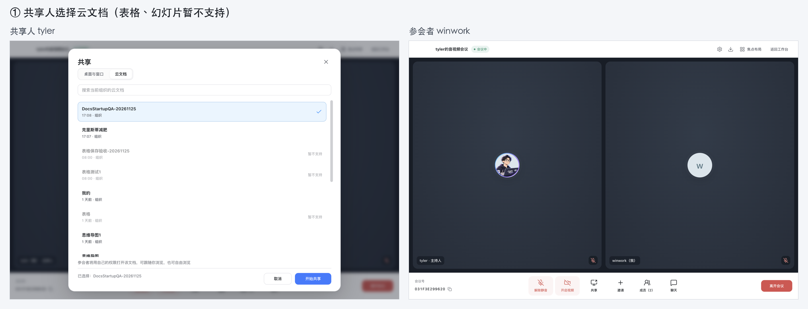
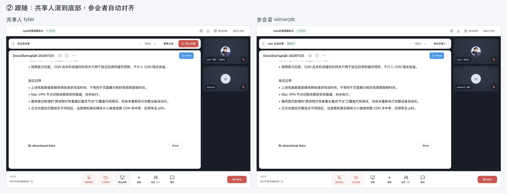
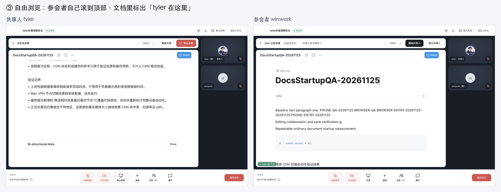
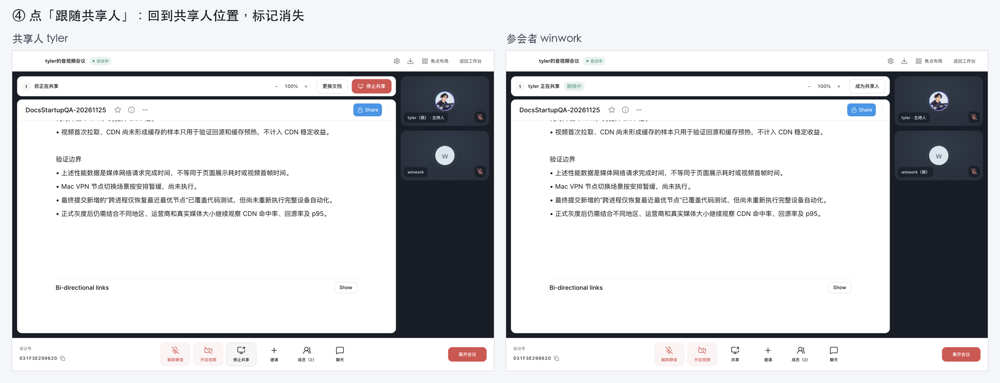
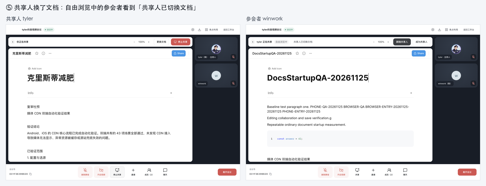
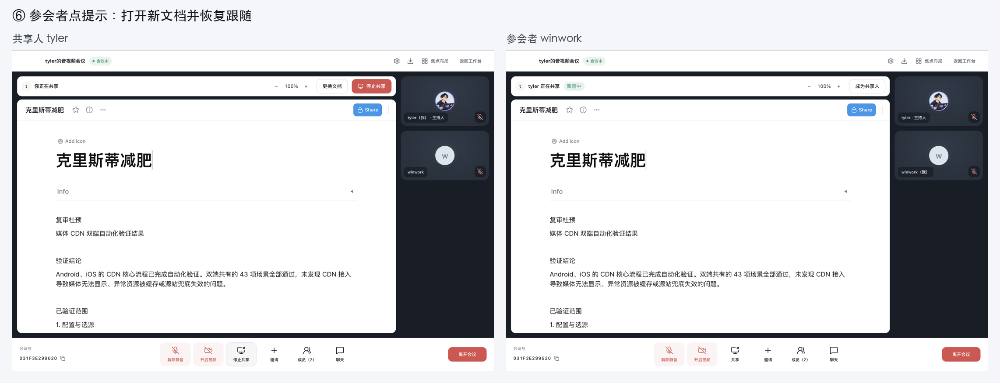
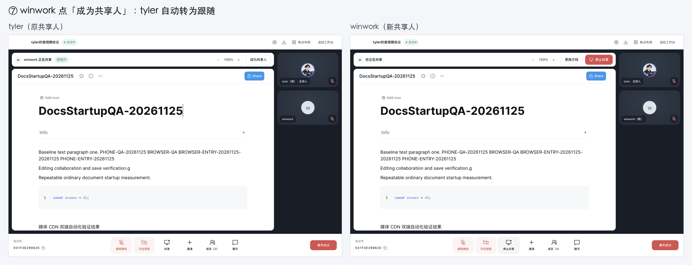

# 会议云文档共享：双端实测

环境：本地 debug Desktop 两个实例，连接测试环境（Work `work.juggle.im`，Docs Web `19b6340c7`）。共享人 tyler，参会者 winwork，同一组织成员。截图左侧是共享人画面，右侧是参会者画面。

| 场景 | 结果 |
|---|---|
| 选择云文档 | 列出组织内最近文档，表格、幻灯片灰显「暂不支持」 |
| 跟随 | 共享人滚动后，参会者约 0.5 秒内对齐到同一位置 |
| 自由浏览 | 参会者自己滚动后进入「自由浏览中」，文档内显示共享人方位标记，状态条显示共享人所在方向 |
| 回到跟随 | 点「跟随共享人」后回到共享人位置，标记消失 |
| 共享人换文档 | 自由浏览中的参会者看到「共享人已切换文档」，点击后打开新文档并恢复跟随 |
| 换人共享 | 参会者点「成为共享人」并选文档，原共享人自动转为跟随 |
| 同步中断 | 共享人停发 10 秒，参会者显示「位置同步已中断」，恢复后回到「跟随中」 |

## ① 选择云文档

## ② 跟随

## ③ 自由浏览与共享人位置标记

## ④ 回到跟随

## ⑤ 共享人换了文档

## ⑥ 跟随到新文档

## ⑦ 换人共享

## 未覆盖

- 无权限成员：测试组织内没有参会者无权访问的文档。
- 打包版 Desktop 的主窗口采集、`isStatus` 限流与输入法。
